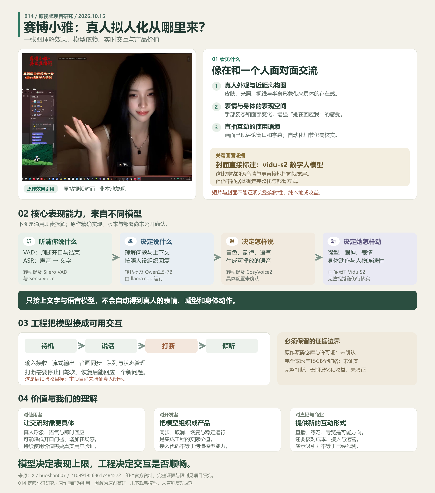

# GitHub 项目研究集

把最近遇到的优秀 GitHub 项目，整理成可以查阅、复现和展示的研究记录。

这里是总入口：按编号浏览项目摘要，进入各子项目查看研究笔记、运行方式、界面截图与演示。每个子项目独立保存代码和依赖，适合同时研究不同技术栈。

网页入口：[研究总览](https://yydshly.github.io/1014_codex_project/) · [014 赛博小雅研究](https://yydshly.github.io/1014_codex_project/014-cyber-xiaoya-study/)。发布与验证见[部署说明](docs/PAGES.md)。

## 项目索引

编号按收录顺序从 `001` 递增，目录采用 `projects/001-project-name/`。编号创建后保持不变，首页始终按编号升序展示。

<!-- PROJECTS:START -->

| 编号 | 项目 | 摘要 | 状态 | 研究记录 | 原仓库 | Web 演示 |
| --- | --- | --- | --- | --- | --- | --- |
| 014 | [赛博小雅：真人拟人化效果与模型依赖研究](projects/014-cyber-xiaoya-study/README.md) | 真人互动角色研究：识别、语言、声音与视觉模型提供听想说动，工程负责同步和打断；价值在在场感，扩展到陪练、讲解、直播与角色记忆。原作源码及完整闭环待核验。 | 研究中 | [研究笔记](projects/014-cyber-xiaoya-study/RESEARCH.md) | [GitHub](https://github.com/yydshly/1014_codex_project) | — |

### 项目配图

#### 014 · 赛博小雅：真人拟人化效果与模型依赖研究



014 原创能力总览图：引用原视频画面，串起真人效果、听想说动模型、实时交互工程、产品价值与证据边界。

[查看项目](projects/014-cyber-xiaoya-study/README.md)

<!-- PROJECTS:END -->

## 开始一个研究

在仓库根目录运行以下命令，将示例名称和地址替换为实际项目：

```sh
python scripts/project_catalog.py add --slug project-name --title "项目名称" --repo "https://github.com/owner/repository" --summary "一句话说明项目用途和研究重点"
```

命令会分配下一个编号、创建子项目目录与研究模板、登记项目信息，并更新上方索引。

随后在子项目内完善研究记录，把截图放入 `assets/`，并在 [projects.json](projects.json) 中填写配图、状态或已经发布的演示链接。更新后运行：

```sh
python scripts/project_catalog.py sync
python scripts/project_catalog.py check
```

## 仓库导航

| 位置 | 用途 |
| --- | --- |
| [projects/](projects/README.md) | 按编号组织的子项目、研究笔记、截图与可选 Web |
| [projects.json](projects.json) | 项目索引的数据来源 |
| [研究与目录约定](docs/CONVENTIONS.md) | 编号、研究流程、配图及来源记录 |
| [Web 展示与部署](docs/DEPLOYMENT.md) | 为后续多个 Web 准备的 GitHub Pages 路径方案 |
| [templates/project/](templates/project/README.md) | 新项目使用的统一模板 |

## 研究方式

先记录原仓库与研究版本，再复现核心功能，最后总结值得学习的设计和实现。首页保留简短摘要，详细结论、截图说明和运行步骤写在对应子项目中。

引用原项目的代码、文档和图片时，在子项目内保留来源及许可证信息；尚未核实的信息标为待确认。
