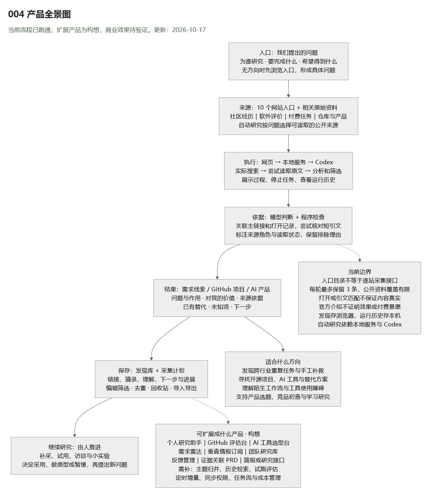
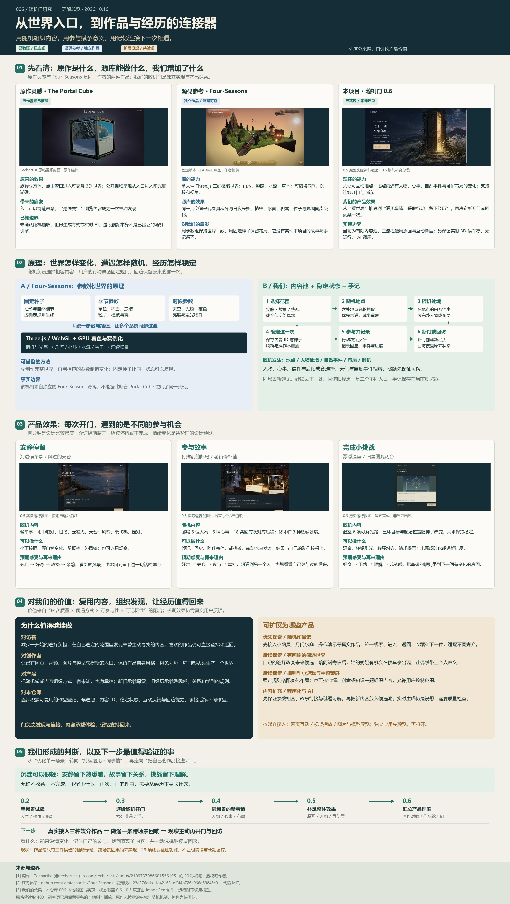
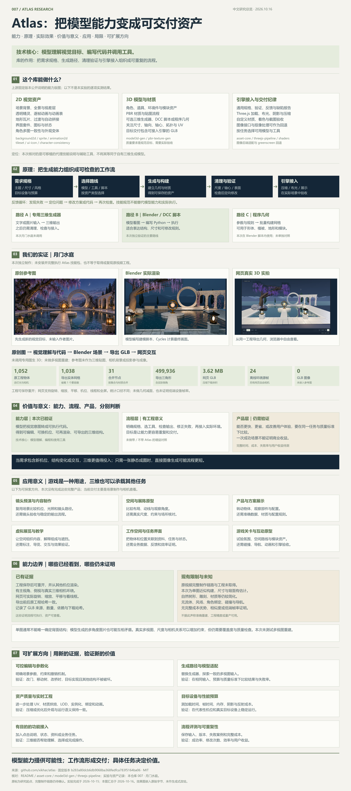
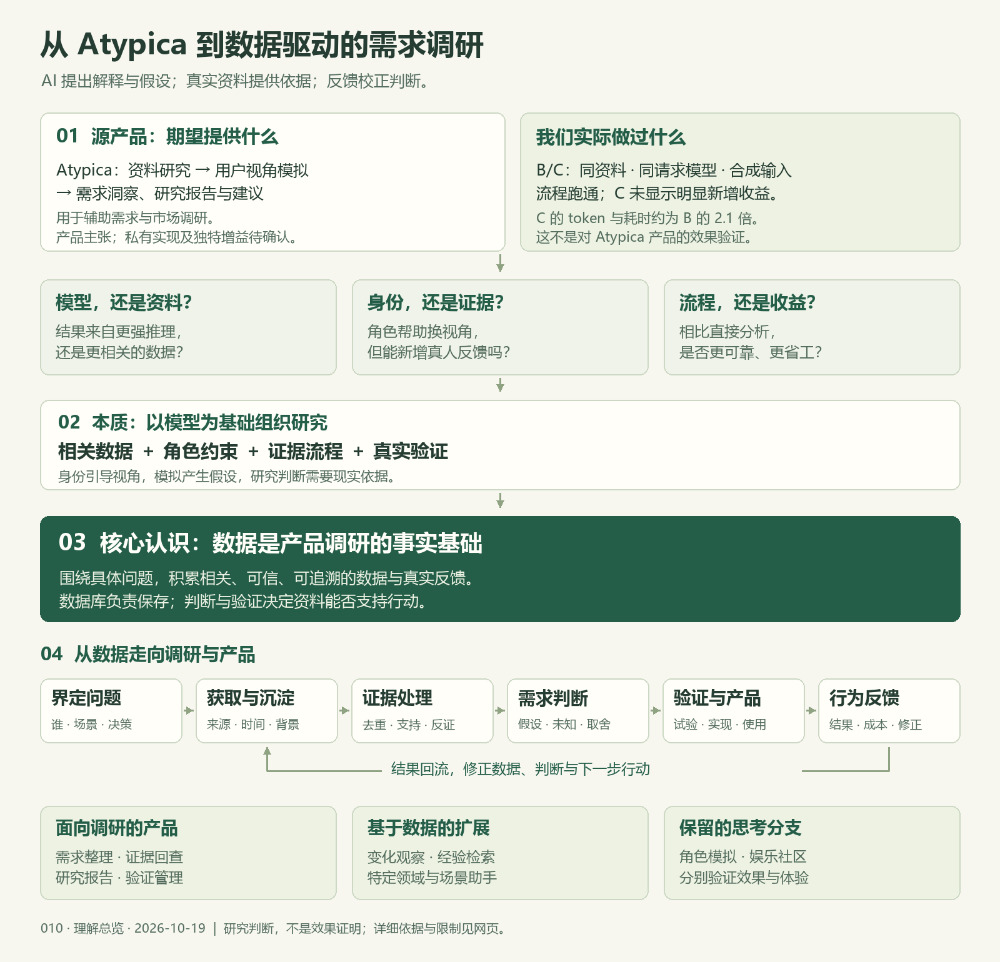
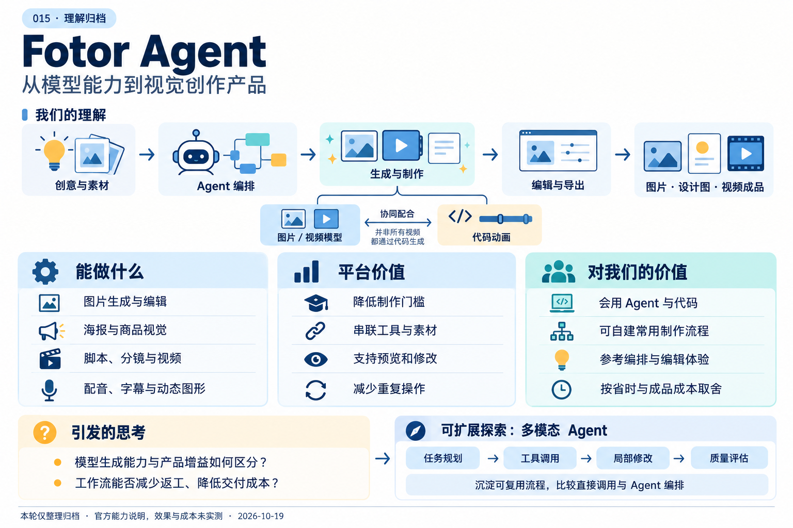

# GitHub 项目研究集

把最近遇到的优秀 GitHub 项目，整理成可以查阅、复现和展示的研究记录。

这里是总入口：按编号浏览项目摘要，进入各子项目查看研究笔记、运行方式、界面截图与演示。每个子项目独立保存代码和依赖，适合同时研究不同技术栈。

网页入口：[研究总览](https://yydshly.github.io/1014_codex_project/) · [014 赛博小雅研究](https://yydshly.github.io/1014_codex_project/014-cyber-xiaoya-study/)。发布与验证见[部署说明](docs/PAGES.md)。

## 项目索引

编号按收录顺序从 `001` 递增，目录采用 `projects/001-project-name/`。编号创建后保持不变，首页始终按编号升序展示。

<!-- PROJECTS:START -->

| 编号 | 项目 | 摘要 | 状态 | 研究记录 | 来源链接 | Web 演示 |
| --- | --- | --- | --- | --- | --- | --- |
| 004 | [从网站入口研究到 AI 研究工作台](projects/004-jasonzhu-ai/README.md) | 从 X 帖子中的网站链接出发，评估并补充寻找需求、GitHub 项目和 AI 产品的入口，逐步扩展为“问题 → 搜索原文 → 分析筛选 → 保存发现”的研究工作台。帮助个人开发者扩大观察范围、积累研究依据，可继续探索工具评估、需求雷达等产品；自动研究需本地 Codex。 | 研究中 | [研究笔记](projects/004-jasonzhu-ai/RESEARCH.md) | [原帖](https://x.com/shenxiankk/status/2107493081146691700) | [演示](https://yydshly.github.io/1014_codex_project/004-jasonzhu-ai/research.html) |
| 006 | [随机门：世界身份实验、源库原理与作品馆](projects/006-random-doors/README.md) | 阶段归档：Four-Seasons 以固定种子与参数联动三维场景；我们保留六地点偶遇、三世界八身份与列车第一人称样本，汇总随机价值、原画与人物深度的不足及完整游戏的投入边界。随机作品馆真实接入留待后续立项。 | 已归档 | [研究笔记](projects/006-random-doors/RESEARCH.md) | [原帖](https://x.com/techartist_/status/2109737086601556195) | [演示](https://yydshly.github.io/1014_codex_project/006-random-doors/research.html) |
| 007 | [Atlas：模型驱动的资产工作流与月门水庭实证](projects/007-autumn-courtyard-blender/README.md) | Atlas 以技能规范和辅助脚本组织 2D/3D 资产生成、验证与引擎接入，底层依赖模型和建模工具；价值在可编辑资产与可重复交付。以月门水庭验证 Blender 脚本路线，探索展陈、教学、产品展示和游戏，流程增益仍待评测。 | 研究中 | [研究笔记](projects/007-autumn-courtyard-blender/RESEARCH.md) | [原帖](https://x.com/xikhar/status/2110143242591510835) | [演示](https://yydshly.github.io/1014_codex_project/007-autumn-courtyard-blender/research.html) |
| 010 | [从 Atypica 到数据驱动的需求调研](projects/010-evidence-research-lab/README.md) | Atypica 以资料研究、用户视角模拟与报告辅助需求和市场调研。我们自建导入、证据与报告原型，同模型同合成资料 B/C 未证明额外流程增益；由此追问模型、身份和流程价值，收束为数据→证据→需求→产品验证→反馈沉淀。可扩展需求雷达、调研工作台和领域助手，效果与付费待验证。 | 已归档 | [研究笔记](projects/010-evidence-research-lab/RESEARCH.md) | [原帖](https://x.com/gkxspace/status/2109970698303373750) | [演示](https://yydshly.github.io/1014_codex_project/010-evidence-research-lab/#synthesis) |
| 014 | [赛博小雅：真人拟人化效果与模型依赖研究](projects/014-cyber-xiaoya-study/README.md) | 真人互动角色研究：识别、语言、声音与视觉模型提供听想说动，工程负责同步和打断；价值在在场感，扩展到陪练、讲解、直播与角色记忆。原作源码及完整闭环待核验。 | 研究中 | [研究笔记](projects/014-cyber-xiaoya-study/RESEARCH.md) | [原帖](https://x.com/huoshan007/status/2109919568617484522) | [演示](https://yydshly.github.io/1014_codex_project/014-cyber-xiaoya-study/) |
| 015 | [Fotor Agent：视觉创作平台的能力、价值与我们的取舍](projects/015-fotor-agent/README.md) | Fotor 将图片与视频模型、Agent 编排和代码动画整合成视觉创作平台，价值在降低制作与修改门槛。对会用 Agent 和代码的我们，主要参考工作流与编辑体验，是否采用取决于省时和成品成本；后续可探索多模态 Agent 的工具协作、局部修改与质量评估。本轮仅整理归档，未做效果实测。 | 已归档 | [研究笔记](projects/015-fotor-agent/RESEARCH.md) | [来源](https://www.fotor.com/agent/) | — |

### 项目配图

#### 004 · 从网站入口研究到 AI 研究工作台



004 产品全景图：问题、来源、搜索读取、分析筛选、发现库、人工验证，以及适用方向、扩展产品与当前边界。

[查看项目](projects/004-jasonzhu-ai/README.md)

#### 006 · 随机门：世界身份实验、源库原理与作品馆



006 我们整理的完整理解总览图：原作与独立源码参考、能力原理、实际效果、三类体验、价值及扩展方向。

[查看项目](projects/006-random-doors/README.md)

#### 007 · Atlas：模型驱动的资产工作流与月门水庭实证



007 专门制作的 Atlas 研究总览图：能力、原理、月门水庭实际效果、价值与意义、应用、边界及扩展方向。

[查看项目](projects/007-autumn-courtyard-blender/README.md)

#### 010 · 从 Atypica 到数据驱动的需求调研



010 原创理解总览图：从 Atypica 研究用途、模型与身份的追问，收束到数据、需求判断、产品验证和反馈；概念总结，非源产品架构或效果证明。

[查看项目](projects/010-evidence-research-lab/README.md)

#### 014 · 赛博小雅：真人拟人化效果与模型依赖研究


014 原创能力总览图：引用原视频画面，串起真人效果、听想说动模型、实时交互工程、产品价值与证据边界。

[查看项目](projects/014-cyber-xiaoya-study/README.md)

#### 015 · Fotor Agent：视觉创作平台的能力、价值与我们的取舍



015 原创理解引导图：Fotor 的图片、设计与视频能力，平台降低制作门槛的价值，对我们的取舍，以及多模态 Agent 的可扩展研究方向；效果与成本未实测。

[查看项目](projects/015-fotor-agent/README.md)

<!-- PROJECTS:END -->

## 开始一个研究

在仓库根目录运行以下命令，将示例名称和地址替换为实际项目：

```sh
python scripts/project_catalog.py add --slug project-name --title "项目名称" --repo "https://github.com/owner/repository" --summary "一句话说明项目用途和研究重点"
```

命令会分配下一个编号、创建子项目目录与研究模板、登记项目信息，并更新上方索引。

随后在子项目内完善研究记录，把截图放入 `assets/`，并在 [projects.json](projects.json) 中填写配图、状态或已经发布的演示链接。更新后运行：

```sh
python scripts/project_catalog.py sync
python scripts/project_catalog.py check
```

## 仓库导航

| 位置 | 用途 |
| --- | --- |
| [projects/](projects/README.md) | 按编号组织的子项目、研究笔记、截图与可选 Web |
| [projects.json](projects.json) | 项目索引的数据来源 |
| [研究与目录约定](docs/CONVENTIONS.md) | 编号、研究流程、配图及来源记录 |
| [Web 展示与部署](docs/DEPLOYMENT.md) | 为后续多个 Web 准备的 GitHub Pages 路径方案 |
| [templates/project/](templates/project/README.md) | 新项目使用的统一模板 |

## 研究方式

先记录原仓库与研究版本，再复现核心功能，最后总结值得学习的设计和实现。首页保留简短摘要，详细结论、截图说明和运行步骤写在对应子项目中。

引用原项目的代码、文档和图片时，在子项目内保留来源及许可证信息；尚未核实的信息标为待确认。
