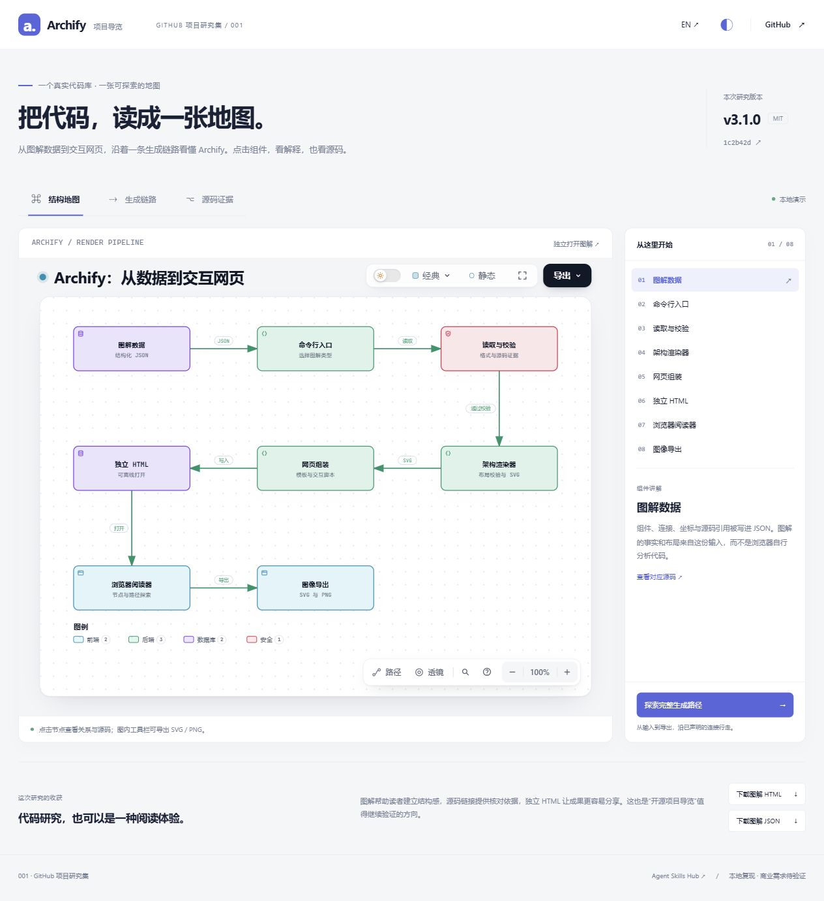
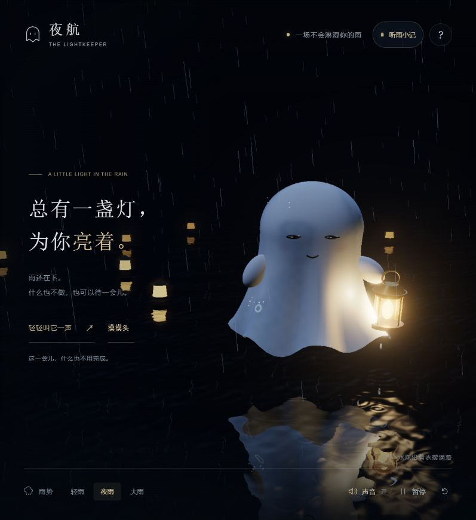
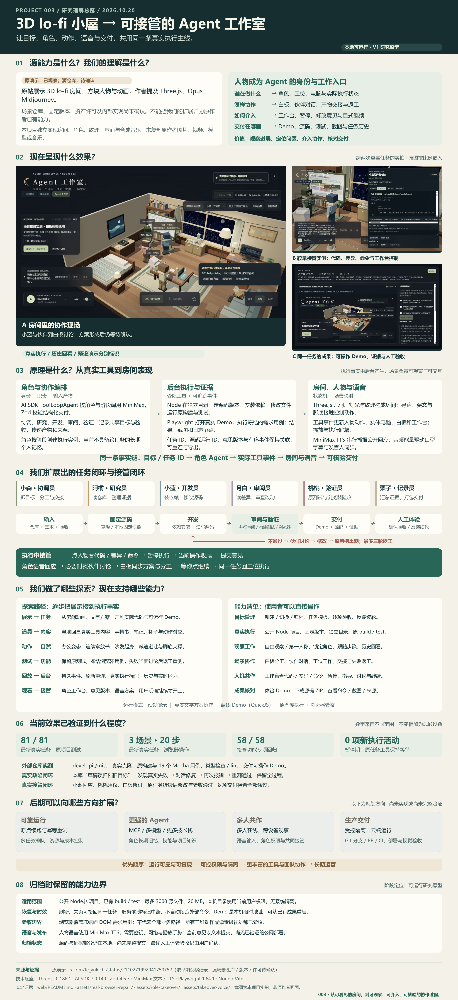
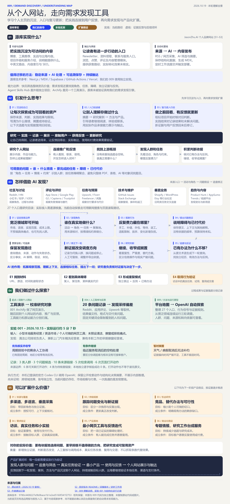
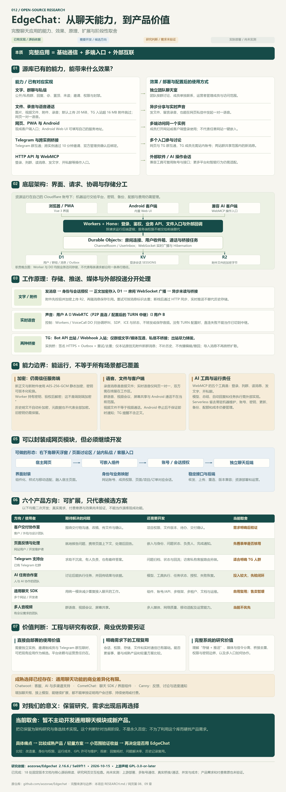

# GitHub 项目研究集

把最近遇到的优秀 GitHub 项目，整理成可以查阅、复现和展示的研究记录。

这里是总入口：收录开源仓库，也保留从原帖、网站和产品出发的独立实验。每个子项目单独记录来源、实现、验证结果与运行方式。

**快速回顾：**[一句话速览](#一句话速览)找能力与价值 → [详细索引](#详细索引)看原理、进展与真实来源 → [项目配图](#项目配图)回忆实际效果。需要复现时进入项目 README，需要判断结论依据时查看研究笔记。

网页入口：[研究总览](https://yydshly.github.io/1014_codex_project/) · [014 赛博小雅研究](https://yydshly.github.io/1014_codex_project/014-cyber-xiaoya-study/)。发布与验证见[部署说明](docs/PAGES.md)。

## 项目索引

编号按收录顺序从 `001` 递增，目录采用 `projects/001-project-name/`。编号创建后保持不变，首页始终按编号升序展示。

总索引收录 **001—015 共 15 项研究**，网页是否上线单独标记；当前公开数量和入口以[研究总览](https://yydshly.github.io/1014_codex_project/)为准。其余可阅读研究记录，运行实验按子项目说明在本地进行。最初的补交范围与编号核对保留在 [研究收录核对](docs/CATALOG_AUDIT.md)，各项目后续发布以部署记录为准。

<!-- PROJECTS:START -->

### 一句话速览

先找想回顾的能力与价值，点击项目名查看完整说明；实现原理、验证进展和来源见下方详细索引。

- **[001 · Archify：交互式代码库图解](projects/001-archify/README.md)**：将代码库整理成可交互的结构图与组件讲解，帮助快速理解架构、追查源码和接手项目。
- **[002 · 夜航：雨夜小幽灵与非语言陪伴](projects/002-rainy-ghost/README.md)**：用雨夜场景、触摸反馈与非语言回应营造安静陪伴，探索轻量互动的情绪价值。
- **[003 · 从3D小屋到可接管的Agent工作室](projects/003-lofi-room/README.md)**：把 3D 小屋扩展为可观察、可接管的 Agent 工作室，让编码任务的执行与协作更直观。
- **[004 · 从网站入口研究到 AI 研究工作台](projects/004-jasonzhu-ai/README.md)**：把问题搜索、原文读取、分析筛选与发现保存串成研究工作台，帮助持续寻找需求、开源项目和 AI 产品。
- **[005 · 小汐：AI 虚拟角色互动实验](projects/005-cyber-companion/README.md)**：把中文对话、语音与 Live2D 表情结合为虚拟角色，探索可打断的自然互动及其实现边界。
- **[006 · 随机门：世界身份实验、源库原理与作品馆](projects/006-random-doors/README.md)**：通过随机地点、世界与身份探索不同互动体验，理解随机性如何服务发现、代入和重复游玩。
- **[007 · Atlas：模型驱动的资产工作流与月门水庭实证](projects/007-autumn-courtyard-blender/README.md)**：用模型与建模工具组织可编辑的 2D/3D 资产制作流程，为展陈、教学、产品展示和游戏积累可复用资产。
- **[008 · Specreel：浏览器记录生成演示与操作备忘](projects/008-specreel/README.md)**：把浏览器操作记录转成分步回放与演示视频，便于制作教程、展示流程和保留操作备忘。
- **[009 · 个人主页启发与需求发现产品探索](projects/009-demand-discovery/README.md)**：借鉴个人主页的研究沉淀与展示方式，延伸到 AI 需求发现和证据追查，让实践与用户反馈推动后续产品探索。
- **[010 · 从 Atypica 到数据驱动的需求调研](projects/010-evidence-research-lab/README.md)**：从 Atypica 的资料研究与用户模拟出发，探索以真实数据和证据支持需求判断及产品验证。
- **[011 · 古人说唱 Battle：AI 视频制作流程研究](projects/011-ancient-rap-battle/README.md)**：把歌曲、人物图与逐句视频串成 AI 说唱制作流程，为音乐短片积累可复用资产和分阶段验收方法。
- **[012 · EdgeChat：自部署聊天系统原理研究](projects/012-edgechat/README.md)**：提供可自部署的聊天、文件与网页语音能力，帮助理解通信架构并评估特定场景中的复用价值。
- **[013 · CrawlHive：跨平台信息监控的能力与本质](projects/013-crawl-hive/README.md)**：持续监控跨平台信息并筛选信号，为动态跟进、产品发现与开源研究提供可追查来源的入口。
- **[014 · 赛博小雅：真人拟人化效果与模型依赖研究](projects/014-cyber-xiaoya-study/README.md)**：研究真人风格角色的听、想、说、动如何形成在场感，为陪练、讲解与直播互动梳理实现路径。
- **[015 · Fotor Agent：视觉创作平台的能力、价值与我们的取舍](projects/015-fotor-agent/README.md)**：把图片、视频与 Agent 编排整合为视觉创作平台，为降低制作和修改门槛提供工作流参考。

### 详细索引

摘要按 **能力 → 原理 → 意义 → 进展** 阅读；能力与原理区分来源项目和我们的扩展，进展保留已验证结果与待确认边界。

来源显示真实仓库名称；技术依赖、独立参考与早期参考单独标明，原帖或产品页保留为补充入口。

| 编号 | 项目 | 摘要 | 状态 | 研究记录 | 源库 / 来源 | Web 演示 |
| --- | --- | --- | --- | --- | --- | --- |
| 001 | [Archify：交互式代码库图解](projects/001-archify/README.md) | **能力：**生成交互式代码库导览，关联结构图、组件说明与源码。<br>**原理：**AI 代理分析代码并整理结构化图解，再经渲染与校验输出 HTML。<br>**意义：**缩短理解陌生项目的路径，辅助架构学习、交接与讲解。<br>**进展：**已本地复现中英文导览，保留固定版本源码证据。 | 已复现 | [研究笔记](projects/001-archify/RESEARCH.md) | 原仓库：[tt-a1i/archify](https://github.com/tt-a1i/archify) | — |
| 002 | [夜航：雨夜小幽灵与非语言陪伴](projects/002-rainy-ghost/README.md) | **能力：**雨夜小幽灵可回应轻抚、脸红与目送，提供本地陪伴和可选计时。<br>**原理：**受原帖氛围启发，用 Three.js 独立实现雨滴、湿布、声音和交互反馈。<br>**意义：**探索无需对话的情绪陪伴，以及场景与细微反馈的表达方式。<br>**进展：**已完成手机布局、手势和自动画质优化，保留当前版本；three.js 是技术依赖。 | 已完成 | [研究笔记](projects/002-rainy-ghost/RESEARCH.md) | 技术依赖：[mrdoob/three.js](https://github.com/mrdoob/three.js)<br>[雨夜小幽灵 · 原帖](https://x.com/chetanankola/status/2110225806849122363) | [演示](https://yydshly.github.io/1014_codex_project/002-rainy-ghost/research.html#synthesis) |
| 003 | [从3D小屋到可接管的Agent工作室](projects/003-lofi-room/README.md) | **能力：**绑定角色身份与语音，观察真实编码、测试和浏览器返工，并在执行中接管。<br>**原理：**受 3D lo-fi 房间启发，将独立场景与本地 Agent 任务执行连接。<br>**意义：**探索任务可视化、人机协作，以及持久执行、多模型工具和多人协作。<br>**进展：**Pages 提供预设体验，真实任务本地运行；原场景仓库待确认，three.js 是技术依赖。 | 已完成 | [研究笔记](projects/003-lofi-room/RESEARCH.md) | 技术依赖：[mrdoob/three.js](https://github.com/mrdoob/three.js)<br>[3D lo-fi 房间 · 原帖](https://x.com/fe_yukichi/status/2110271992041750752) | [演示](https://yydshly.github.io/1014_codex_project/003-lofi-room/research.html#synthesis) |
| 004 | [从网站入口研究到 AI 研究工作台](projects/004-jasonzhu-ai/README.md) | **能力：**整理研究入口，按问题搜索原文、筛选信息并保存发现。<br>**原理：**公开来源 → 搜索读取 → 模型分析与来源检查 → 发现库 → 人工验证。<br>**意义：**扩大个人开发者的观察范围，积累研究依据，可扩展工具评估与需求雷达。<br>**进展：**已形成独立工作台，自动研究需本地 Codex；jasonzhu.ai 为早期个人网站参考。 | 研究中 | [研究笔记](projects/004-jasonzhu-ai/RESEARCH.md) | 早期参考：[zhuyansen/jasonzhu.ai](https://github.com/zhuyansen/jasonzhu.ai)<br>[网站入口研究 · 原帖](https://x.com/shenxiankk/status/2107493081146691700) | [演示](https://yydshly.github.io/1014_codex_project/004-jasonzhu-ai/research.html) |
| 005 | [小汐：AI 虚拟角色互动实验](projects/005-cyber-companion/README.md) | **能力：**Live2D 角色进行中文对话、语音回应、表情变化与交互打断。<br>**原理：**参考 Open-LLM-VTuber，将对话模型、语音与角色表现连接为本地原型。<br>**意义：**理解虚拟角色的互动链路，积累陪伴、讲解与角色界面的实现经验。<br>**进展：**已跑通 Live2D 互动；真人实时闭环仍缺数字人服务，未达到真人目标。 | 研究中 | [研究笔记](projects/005-cyber-companion/RESEARCH.md) | 原仓库：[Open-LLM-VTuber/Open-LLM-VTuber](https://github.com/Open-LLM-VTuber/Open-LLM-VTuber) | — |
| 006 | [随机门：世界身份实验、源库原理与作品馆](projects/006-random-doors/README.md) | **能力：**独立探索六地点偶遇、三世界八身份与列车第一人称体验。<br>**原理：**参考 Four-Seasons 的固定种子与场景参数联动；我们的世界按身份、权限和规则组合。<br>**意义：**比较氛围、故事与挑战的回访动机，理解随机体验和完整游戏的投入边界。<br>**进展：**阶段归档；人物深度与原画仍有不足，作品馆真实接入待立项；参考库并非原帖源码。 | 已归档 | [研究笔记](projects/006-random-doors/RESEARCH.md) | 独立参考：[iamtechartist/Four-Seasons](https://github.com/iamtechartist/Four-Seasons)<br>[传送门立方体 · 原帖](https://x.com/techartist_/status/2109737086601556195) | [演示](https://yydshly.github.io/1014_codex_project/006-random-doors/research.html) |
| 007 | [Atlas：模型驱动的资产工作流与月门水庭实证](projects/007-autumn-courtyard-blender/README.md) | **能力：**Atlas 组织资产生成、质量验证与引擎接入，我们以月门水庭验证 Blender 脚本路线。<br>**原理：**技能规范与辅助脚本协调模型、生成器和建模工具，按反馈修改并导出检查。<br>**意义：**保留可编辑结构，支持换机位、定向修改、交互扩展与重复交付。<br>**进展：**已交付场景工程与网页演示；相对直接使用模型的流程增益仍待评测。 | 研究中 | [研究笔记](projects/007-autumn-courtyard-blender/RESEARCH.md) | 原仓库：[xikhar/atlas](https://github.com/xikhar/atlas)<br>[Atlas · 原帖](https://x.com/xikhar/status/2110143242591510835) | [演示](https://yydshly.github.io/1014_codex_project/007-autumn-courtyard-blender/research.html) |
| 008 | [Specreel：浏览器记录生成演示与操作备忘](projects/008-specreel/README.md) | **能力：**记录网页操作并生成可回放步骤和演示视频。<br>**原理：**Playwright 采集动作与画面，Specreel 生成结果，可选 Agent 与模型编排。<br>**意义：**复用已有操作流程制作教程、产品演示与备忘，准备后可无人值守执行。<br>**进展：**已实测 004 的三条流程并比较录屏方案，尚未证明整体省时。 | 已复现 | [研究笔记](projects/008-specreel/RESEARCH.md) | 原仓库：[specreel/specreel](https://github.com/specreel/specreel) | [演示](https://yydshly.github.io/1014_codex_project/008-specreel/#synthesis) |
| 009 | [个人主页启发与需求发现产品探索](projects/009-demand-discovery/README.md) | **能力：**JasonZhu.AI 展示博客、工具、项目与服务；我们延伸出需求发现和证据追查实验。<br>**原理：**原站用 AI 管线更新快讯；我们的路径是研究 → 实践 → 记录 → 展示 → 用户反馈 → 更新。<br>**意义：**把研究变成可回顾、可展示的积累，再探索需求验证与产品化。<br>**进展：**已跑通三轮本地探索，公开页展示真实档案；持续使用与付费待验证。 | 研究中 | [研究笔记](projects/009-demand-discovery/RESEARCH.md) | 原仓库：[zhuyansen/jasonzhu.ai](https://github.com/zhuyansen/jasonzhu.ai)<br>[JasonZhu.AI · 网站](https://jasonzhu.ai/) | [演示](https://yydshly.github.io/1014_codex_project/009-demand-discovery/#synthesis) |
| 010 | [从 Atypica 到数据驱动的需求调研](projects/010-evidence-research-lab/README.md) | **能力：**Atypica 辅助需求与市场调研；我们自建资料导入、证据整理与报告原型。<br>**原理：**以资料研究和用户视角模拟辅助分析，收束为数据 → 证据 → 需求 → 产品验证 → 反馈。<br>**意义：**辨别模型、身份和流程各自的作用，为需求雷达、调研工作台与领域助手积累方法。<br>**进展：**已归档；同模型、同合成资料的 B/C 对照未证明额外流程增益，效果与付费待验证。 | 已归档 | [研究笔记](projects/010-evidence-research-lab/RESEARCH.md) | [Atypica · 原帖](https://x.com/gkxspace/status/2109970698303373750) | [演示](https://yydshly.github.io/1014_codex_project/010-evidence-research-lab/#synthesis) |
| 011 | [古人说唱 Battle：AI 视频制作流程研究](projects/011-ancient-rap-battle/README.md) | **能力：**编排歌曲、人物图与视频生成，制作古人说唱短片。<br>**原理：**以歌曲音频和人物图驱动远端逐句视频，再修复、合成并分阶段验收。<br>**意义：**沉淀音乐短片制作流程、可复用角色资产与质量检查经验。<br>**进展：**已制作 94.64 秒《压轴人间》，保留原曲驱动修复、验收与扩展记录。 | 研究中 | [研究笔记](projects/011-ancient-rap-battle/RESEARCH.md) | 原仓库：[10291124jcjc-dotcom/ancient-rap-battle](https://github.com/10291124jcjc-dotcom/ancient-rap-battle) | [演示](https://yydshly.github.io/1014_codex_project/011-ancient-rap-battle/) |
| 012 | [EdgeChat：自部署聊天系统原理研究](projects/012-edgechat/README.md) | **能力：**自部署聊天、文件传输、网页一对一语音及限定桥接。<br>**原理：**基于 Cloudflare 的服务组织消息、连接与存储，具体架构见研究笔记。<br>**意义：**学习通信架构，评估特定场景接入和工程复用，保留六类产品假设。<br>**进展：**已整理架构与能力边界，暂不开发通用聊天产品，待真实需求再评估。 | 研究中 | [研究笔记](projects/012-edgechat/RESEARCH.md) | 原仓库：[aozorae/Edgechat](https://github.com/aozorae/Edgechat) | [演示](https://yydshly.github.io/1014_codex_project/012-edgechat/#synthesis) |
| 013 | [CrawlHive：跨平台信息监控的能力与本质](projects/013-crawl-hive/README.md) | **能力：**CrawlHive 监控 X、频道、网页与行情；我们自建 AI 方向工作台并整理 21 项来源接法。<br>**原理：**任务调度与增量获取 → 规则或可选 AI 处理 → 去重检查 → 信号交付。<br>**意义：**积累来源接入和持续处理经验，探索按主题与目的筛选、留存证据的研究入口。<br>**进展：**已整理源码机制和原型实测，来源接入候选不等于全部接通，实际收益待评估。 | 研究中 | [研究笔记](projects/013-crawl-hive/RESEARCH.md) | 原仓库：[h100envy/crawl-hive](https://github.com/h100envy/crawl-hive) | [演示](https://yydshly.github.io/1014_codex_project/013-crawl-hive/#synthesis) |
| 014 | [赛博小雅：真人拟人化效果与模型依赖研究](projects/014-cyber-xiaoya-study/README.md) | **能力：**研究真人风格角色的语音交流、视觉表现与拟人化互动效果。<br>**原理：**按识别、语言、声音与视觉模型拆解听想说动，工程负责同步和打断；原作链路待核验。<br>**意义：**理解在场感的来源，探索陪练、讲解、直播与角色记忆。<br>**进展：**已整理效果、模型依赖与工程边界；原作源码及完整实时闭环尚未核验。 | 研究中 | [研究笔记](projects/014-cyber-xiaoya-study/RESEARCH.md) | [赛博小雅 · 原帖](https://x.com/huoshan007/status/2109919568617484522) | [演示](https://yydshly.github.io/1014_codex_project/014-cyber-xiaoya-study/) |
| 015 | [Fotor Agent：视觉创作平台的能力、价值与我们的取舍](projects/015-fotor-agent/README.md) | **能力：**整合图片、设计、视频与代码动画的视觉创作能力。<br>**原理：**由 Agent 编排图片与视频模型及相关工具，组织生成和修改流程。<br>**意义：**参考编辑体验与工具协作，探索局部修改和质量评估；是否采用取决于省时与成品成本。<br>**进展：**本轮仅整理归档，未实测效果与成本。 | 已归档 | [研究笔记](projects/015-fotor-agent/RESEARCH.md) | [Fotor Agent · 产品页](https://www.fotor.com/agent/) | — |

### 项目配图

#### 001 · Archify：交互式代码库图解



001 Archify 本地演示：交互式结构图、组件讲解与固定版本源码证据。

[查看项目](projects/001-archify/README.md)

#### 002 · 夜航：雨夜小幽灵与非语言陪伴



002 最终版本实际效果：摸头眯眼、白布小幽灵、暖色提灯与雨夜水面；沿用现有截图，不重新制图。

[查看项目](projects/002-rainy-ghost/README.md)

#### 003 · 从3D小屋到可接管的Agent工作室



003 理解总览：来源能力、运行原理、独立扩展、探索过程、三张实际截图、当前能力、验证与后续方向。

[查看项目](projects/003-lofi-room/README.md)

#### 004 · 从网站入口研究到 AI 研究工作台


004 产品全景图：问题、来源、搜索读取、分析筛选、发现库、人工验证，以及适用方向、扩展产品与当前边界。

[查看项目](projects/004-jasonzhu-ai/README.md)

#### 005 · 小汐：AI 虚拟角色互动实验


005 小汐实际运行截图：Live2D 角色、真实模型聊天、中文语音与音频驱动嘴型。

[查看项目](projects/005-cyber-companion/README.md)

#### 006 · 随机门：世界身份实验、源库原理与作品馆


006 我们整理的完整理解总览图：原作与独立源码参考、能力原理、实际效果、三类体验、价值及扩展方向。

[查看项目](projects/006-random-doors/README.md)

#### 007 · Atlas：模型驱动的资产工作流与月门水庭实证


007 专门制作的 Atlas 研究总览图：能力、原理、月门水庭实际效果、价值与意义、应用、边界及扩展方向。

[查看项目](projects/007-autumn-courtyard-blender/README.md)

#### 008 · Specreel：浏览器记录生成演示与操作备忘


008原创理解总结图：脚本与可选Agent链路、浏览器记录与视频生成原理、自动执行边界、三条实际成品、录屏对比、指导与备忘场景、个人价值与取舍。

[查看项目](projects/008-specreel/README.md)

#### 009 · 个人主页启发与需求发现产品探索



009 理解全景图：原库个人主页与自动内容能力，沉淀、入口和复习更新的直接启发，已有探索，以及需求发现与产品化扩展；区分事实、实测和假设。

[查看项目](projects/009-demand-discovery/README.md)

#### 010 · 从 Atypica 到数据驱动的需求调研


010 原创理解总览图：从 Atypica 研究用途、模型与身份的追问，收束到数据、需求判断、产品验证和反馈；概念总结，非源产品架构或效果证明。

[查看项目](projects/010-evidence-research-lab/README.md)

#### 011 · 古人说唱 Battle：AI 视频制作流程研究


011原创研究引导图：源库原作、我们的探索与94.64秒舞台成片真实画面对照，说明音频驱动、制作价值与验收边界。

[查看项目](projects/011-ancient-rap-battle/README.md)

#### 012 · EdgeChat：自部署聊天系统原理研究



012 沿用已生成的原创总结图：源库能力与效果、Cloudflare 原理、网页接入、六类扩展假设、价值与当前取舍。

[查看项目](projects/012-edgechat/README.md)

#### 013 · CrawlHive：跨平台信息监控的能力与本质


013 CrawlHive 理解总览：从原库监控链路到通用AI探索，区分源码实现、原型实测和来源接入候选。

[查看项目](projects/013-crawl-hive/README.md)

#### 014 · 赛博小雅：真人拟人化效果与模型依赖研究


014 原创能力总览图：引用原视频画面，串起真人效果、听想说动模型、实时交互工程、产品价值与证据边界。

[查看项目](projects/014-cyber-xiaoya-study/README.md)

#### 015 · Fotor Agent：视觉创作平台的能力、价值与我们的取舍


015 原创理解引导图：Fotor 的图片、设计与视频能力，平台降低制作门槛的价值，对我们的取舍，以及多模态 Agent 的可扩展研究方向；效果与成本未实测。

[查看项目](projects/015-fotor-agent/README.md)

<!-- PROJECTS:END -->

## 浏览与运行

在线浏览从[研究总览](https://yydshly.github.io/1014_codex_project/)进入；各项目的演示链接见上方索引。公开静态体验与本地实时功能的区别，以子项目运行说明为准。

本地可从 [项目首页](http://127.0.0.1:4175/1014_codex_project/) 浏览全部项目。启动 `projects/003-lofi-room/web/start.ps1` 后，001、002 的已有构建和 003 的两个场景共用这个入口；003 同时保留 [夜半小屋](http://127.0.0.1:4175/1014_codex_project/003-lofi-room/?view=room) 与 [Agent 工作室](http://127.0.0.1:4175/1014_codex_project/003-lofi-room/?view=workspace)。003 的公开 Pages 版提供研究摘要和预设体验，实时任务继续本地运行。

## 开始一个研究

在仓库根目录运行以下命令，将示例名称和地址替换为实际项目：

```sh
python scripts/project_catalog.py add --slug project-name --title "项目名称" --repo "https://github.com/owner/repository" --summary "一句话说明项目用途和研究重点"
```

命令会分配下一个编号、创建子项目目录与研究模板、登记项目信息，并更新上方索引。

随后在子项目内完善研究记录，把截图放入 `assets/`，并在 [projects.json](projects.json) 中维护一句话 `summary`、按能力／原理／意义／进展组织的 `summary_details`、真实来源、配图和已发布的演示链接。字段规则见[研究与目录约定](docs/CONVENTIONS.md#索引数据)；速览、索引和配图统一自动生成。更新后运行：

```sh
python scripts/project_catalog.py sync
python scripts/project_catalog.py check
```

## 仓库导航

| 位置 | 用途 |
| --- | --- |
| [projects/](projects/README.md) | 按编号组织的子项目、研究笔记、截图与可选 Web |
| [projects.json](projects.json) | 项目索引的数据来源 |
| [研究与目录约定](docs/CONVENTIONS.md) | 编号、研究流程、配图及来源记录 |
| [Web 展示与部署](docs/DEPLOYMENT.md) | 为后续多个 Web 准备的 GitHub Pages 路径方案 |
| [templates/project/](templates/project/README.md) | 新项目使用的统一模板 |

## 研究方式

先记录原仓库与研究版本，再复现核心功能，最后总结值得学习的设计和实现。首页保留简短摘要，详细结论、截图说明和运行步骤写在对应子项目中。

引用原项目的代码、文档和图片时，在子项目内保留来源及许可证信息；尚未核实的信息标为待确认。
