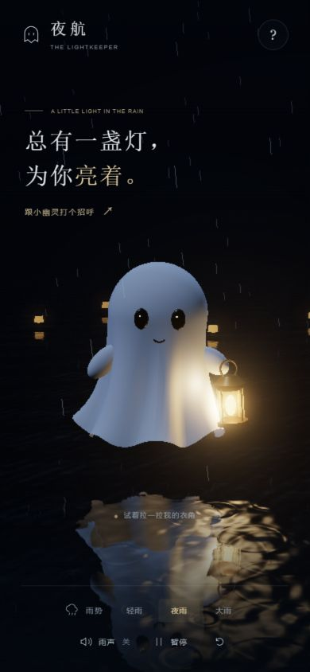

# 项目配图

| 文件 | 内容 | 来源 | 日期 / 版本 |
| --- | --- | --- | --- |
| preview.jpg | 桌面雨夜、白布幽灵、提灯、水面倒影和控制栏，1280 × 800 | 本项目生产构建的本地浏览器实际截图，由 Codex 拍摄 | 2026-10-14，Three.js 0.186.1 |
| mobile.jpg | 手机竖屏布局和底部控制栏，390 × 844 | 本项目生产构建的本地浏览器实际截图，由 Codex 拍摄 | 2026-10-14，Three.js 0.186.1 |
| orbit.jpg | 拖动背景后的环绕视角，展示幽灵侧面和随视角变化的水面倒影 | 本项目加入 OrbitControls 后的本地浏览器实际截图，由 Codex 拍摄 | 2026-10-14，Three.js 0.186.1 |
| rain-impact.jpg | 雨滴命中斗篷时的小水珠、接触圆纹与渐湿材质，含雨势和湿润状态提示 | 本项目加入降雨反应后的本地浏览器实际截图，由 Codex 拍摄 | 2026-10-14，Three.js 0.186.1 |
| audit-2026-10-14/01-desktop.jpg | 体验审查：大雨下湿布高光、桌面构图与控制栏 | 本轮本地生产构建实际截图，由 Codex 拍摄 | 2026-10-14，Three.js 0.186.1 |
| audit-2026-10-14/02-gesture-paused.jpg | 体验审查：暂停与短距离拖动验证后的场景 | 本轮本地生产构建实际截图，由 Codex 拍摄；交互前后数值见 RESEARCH.md | 2026-10-14，Three.js 0.186.1 |
| audit-2026-10-14/03-mobile-short.jpg | 体验审查：390 × 560 矮屏中的标题和角色重叠、底部控制尺寸 | 本轮本地生产构建实际截图，由 Codex 拍摄 | 2026-10-14，Three.js 0.186.1 |
| optimized/desktop.jpg | 优化后：局部湿斑、柔和布料与衣摆滴水，1280 × 800 | 本项目优化后的生产构建实际截图，由 Codex 拍摄 | 2026-10-14，Three.js 0.186.1 |
| optimized/mobile-short.jpg | 优化后：390 × 560 标题与角色分离，底部按钮高度 44 px | 本项目优化后的生产构建实际截图，由 Codex 拍摄 | 2026-10-14，Three.js 0.186.1 |
| optimized/mobile.jpg | 优化后：390 × 844 竖屏构图 | 本项目优化后的生产构建实际截图，由 Codex 拍摄 | 2026-10-14，Three.js 0.186.1 |
| optimized/mobile-landscape.jpg | 优化后：568 × 320 小尺寸横屏，文字与角色分列，底部单行控制 | 本项目优化后的生产构建实际截图，由 Codex 拍摄 | 2026-10-14，Three.js 0.186.1 |
| adaptive/mobile.jpg | 自动画质：390 × 844 手机视口中保留湿布、暖光、倒影与降雨；本次会话由均衡自动恢复到细腻档 | 本项目自动画质版本的本地生产构建实际截图，由 Codex 拍摄；对应运行状态见 adaptive/checks.json | 2026-10-14，Three.js 0.186.1 |
| adaptive/desktop.jpg | 自动画质版本的桌面场景，使用同一套白布材质与灯光 | 本项目自动画质版本的本地生产构建实际截图，由 Codex 拍摄 | 2026-10-14，Three.js 0.186.1 |
| focus/desktop.jpg | 专注入口、任务表单、累计陪伴与完成记录；右侧保留幽灵与原有水面交互，1280 × 800 | 本项目专注扩展的本地生产构建实际截图，由 Codex 拍摄；记录为本地验证产生，无预置数据 | 2026-10-14，Three.js 0.186.1 |
| focus/mobile.jpg | 手机专注暂停面板、可恢复的倒计时、累计记录，390 × 844 | 本项目专注扩展的本地生产构建实际截图，由 Codex 拍摄 | 2026-10-14，Three.js 0.186.1 |
| focus/completed.jpg | 完成后保留原雨夜画面并显示轻量点灯提示，1280 × 800 | 本项目专注扩展的本地生产构建实际截图，由 Codex 拍摄；在奖励灯位置微调前拍摄 | 2026-10-14，Three.js 0.186.1 |
| companion/desktop.jpg | 自然陪伴：轻轻叫它时，小幽灵在原雨夜场景中用动作与短句回应，1280 × 800 | 本项目自然陪伴版本的本地生产构建实际截图，由 Codex 拍摄 | 2026-10-14，Three.js 0.186.1 |
| companion/mobile.jpg | 自然陪伴：短句位于标题与角色之间，保留手机雨夜与水面倒影，390 × 844 | 本项目自然陪伴版本的本地生产构建实际截图，由 Codex 拍摄 | 2026-10-14，Three.js 0.186.1 |
| companion/memory.jpg | 听雨小记：本次与累计相处、熟悉招呼、安静偏好与可选专注入口 | 本项目自然陪伴版本的本地生产构建实际截图，由 Codex 拍摄；数据来自本地验证与既有使用 | 2026-10-14，Three.js 0.186.1 |
| sound/desktop.jpg | 角色声和雨声独立开关、音量与三种试听，保留原有雨夜 | 本项目角色音色版本的本地生产构建实际截图，由 Codex 拍摄 | 2026-10-15，Three.js 0.186.1 |
| sound/mobile.jpg | 390 × 844 手机声音面板 | 本项目角色音色版本的本地生产构建实际截图，由 Codex 拍摄 | 2026-10-15，Three.js 0.186.1 |
| sound/mobile-short.jpg | 390 × 560 矮屏声音面板，可内部滚动，试听按钮高 44 px | 本项目角色音色版本的本地生产构建实际截图，由 Codex 拍摄 | 2026-10-15，Three.js 0.186.1 |
| sound/soft/desktop.jpg | 软糯叫声版：开心、害羞、安心三种试听与原有雨夜 | 本项目第二版角色音色的本地生产构建实际截图，由 Codex 拍摄 | 2026-10-15，Three.js 0.186.1 |
| sound/soft/mobile.jpg | 390 × 560 矮屏的三种情绪叫声试听 | 同上，手机视口检查 | 2026-10-15，Three.js 0.186.1 |
| pet/desktop.jpg | 轻点头顶后害羞缩身与眯眼，保留雨夜与提灯 | 本项目摸头版本本地生产构建的实际截图，由 Codex 拍摄 | 2026-10-15，Three.js 0.186.1 |
| pet/mobile.jpg | 手机视口中的摸头入口与缩身动作 | 同上，手机视口检查 | 2026-10-15，Three.js 0.186.1 |
| pet/mobile-short.jpg | 390 × 560 矮屏的摸头入口与雨夜构图 | 同上，矮屏检查 | 2026-10-15，Three.js 0.186.1 |
| pet/idle.jpg | 安静待着时偶尔缓缓眯眼，不发声 | 同上，实际待机动作截图 | 2026-10-15，Three.js 0.186.1 |
| pet/blush/desktop.jpg | 直接轻点角色头顶后缩身与淡淡脸红 | 本项目脸红版本本地生产构建的实际截图，由 Codex 拍摄 | 2026-10-15，Three.js 0.186.1 |
| pet/blush/orbit.jpg | 换视角时脸红贴合脸颊，保留原雨夜灯光 | 同上，暂停后换视角检查 | 2026-10-15，Three.js 0.186.1 |
| pet/blush/mobile.jpg | 手机视口中直接点按头顶触发脸红 | 同上，手机视口检查 | 2026-10-15，Three.js 0.186.1 |
| pet/stroke/desktop.jpg | 轻抚手形与头顶提示，保留原有缩身、脸红和雨夜 | 本项目轻抚版本本地生产构建的实际截图，由 Codex 拍摄 | 2026-10-15，Three.js 0.186.1 |
| pet/stroke/mobile.jpg | 手机视口中的头部轻抚与身体拖动区域 | 同上，手机视口检查 | 2026-10-15，Three.js 0.186.1 |
| pet/nuzzle/desktop.jpg | 连续轻抚扩展后的桌面雨夜，截图为保留的短暂摸头眯眼、淡脸红反应，1280 × 800 | 本项目本地生产构建的实际截图，由 Codex 拍摄；连续歪头轻蹭时序另由测试验证，边界见同目录 checks.json | 2026-10-15，Three.js 0.186.1 |
| pet/nuzzle/mobile.jpg | 同一构建的手机摸头反应和雨夜布局，390 × 844 | 同上，手机视口检查；非手机实机截图 | 2026-10-15，Three.js 0.186.1 |
| pet/farewell/desktop.jpg | 无声目送扩展后，保留的雨夜与短暂摸头反应，默认桌面窗口 | 本项目本地生产构建实际截图，由 Codex 拍摄；目送方向与完整时序由测试验证，边界见同目录 checks.json | 2026-10-15，Three.js 0.186.1 |
| pet/farewell/mobile.jpg | 同一构建的手机雨夜布局和摸头反应，390 × 844 | 同上，手机视口检查；非手机实机截图 | 2026-10-15，Three.js 0.186.1 |
| ../web/public/pet-hand.svg | 32 × 32 轻抚手形光标 | 本项目独立绘制 SVG，没有外部图片素材 | 2026-10-15 |

图片展示本项目独立编写的场景，没有将原作者媒体文件下载进仓库。

视觉灵感：[Chetan Ankola 的原帖](https://x.com/chetanankola/status/2110225806849122363)。原作品资源许可证待确认，本项目未再分发其媒体文件。

## 独立合成的声音

| 文件 | 内容 | 来源与日期 |
| --- | --- | --- |
| sound/greet.wav | 招呼：柔软上扬的空腔鸣响 | 本项目 ghost-voice.js 程序合成，2026-10-15 |
| sound/nod.wav | 认得你：较短、较圆的熟悉回应 | 同上，无人声或外部采样 |
| sound/settled.wav | 安心：慢慢落下的短回响 | 同上，无人声或外部采样 |
| sound/voice-preview.wav | 上述三种音色依次播放，约 7 秒；使用默认 45% 回应音量，不含雨声 | 同一合成器由 scripts/voice-preview.mjs 导出，2026-10-15 |

全部为 48 kHz、16 bit 单声道 PCM WAV。程序未下载原帖音频，也没有使用 TTS 或录制人声。信号检查见 sound/signal-checks.json；这些试听文件用于展示，网页运行时按需本地合成，不请求这些文件。

第二版采用更圆润、更贴近角色的非语言叫声，保留上面的初版文件供对照。

| 文件 | 内容 | 来源与日期 |
| --- | --- | --- |
| sound/soft/happy.wav | 开心：两次轻快上扬、圆润的弹跳叫声 | 本项目 ghost-voice.js 程序合成，2026-10-15 |
| sound/soft/shy.wav | 害羞：更轻的两次短叫，中间略有停顿 | 同上，无人声或外部采样 |
| sound/soft/pet.wav | 摸头：更短更轻的一声害羞小叫，约 0.795 秒 | 同上，配合摸头缩身动作，无人声或外部采样 |
| sound/soft/settled.wav | 安心：低低地、缓缓舒展开来的长叫声 | 同上，无人声或外部采样 |
| sound/soft/voice-preview.wav | 开心、害羞、安心依次播放，约 6.5 秒，使用默认回应音量，无雨声 | 同一合成器由 scripts/voice-preview.mjs 导出，2026-10-15 |

格式仍为 48 kHz、16 bit 单声道 PCM WAV。信号检查见 sound/soft/signal-checks.json，页面联动验证见 sound/soft/checks.json；网页按需合成，不读取这些试听文件。

## 2026-10-19 发布检查截图

`publication/01-summary-desktop.jpg` 为公网摘要首屏，`02-synthesis-desktop.jpg` 与 `03-synthesis-mobile.jpg` 为本地摘要和 390 × 844 视口检查，`04-public-summary.jpg` 为公网摘要章节，`05-public-scene.jpg` 为公网雨夜加载。均为本项目实际网页截图，只作本轮验收证据；引导图仍是原来的 `pet/farewell/desktop.jpg`。
