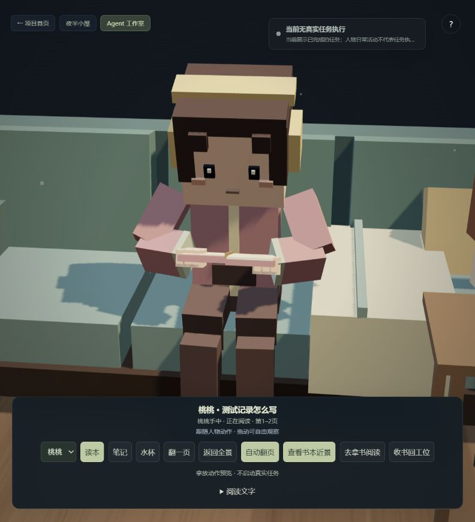
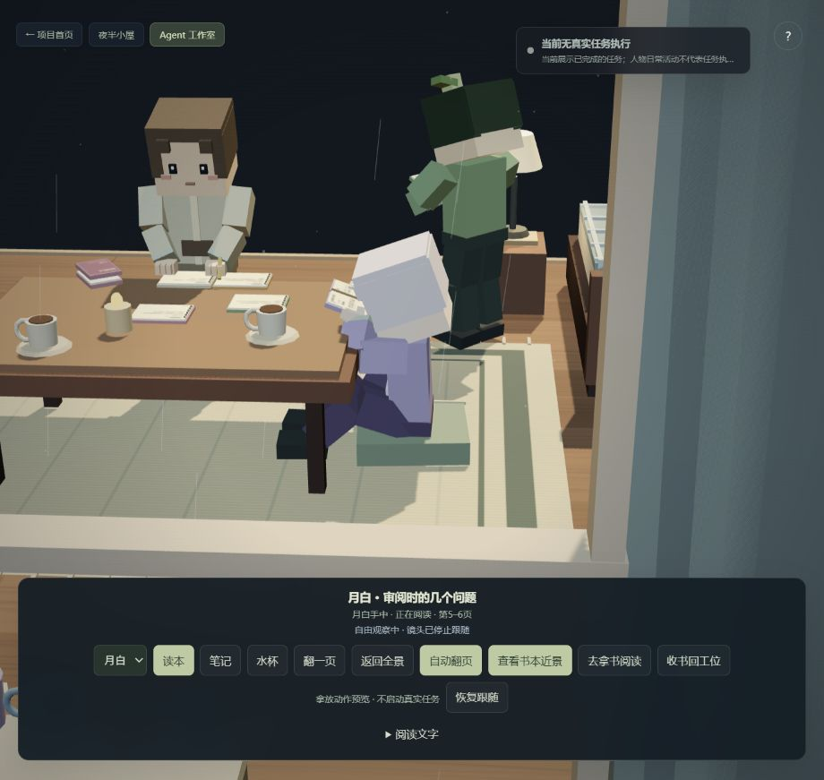
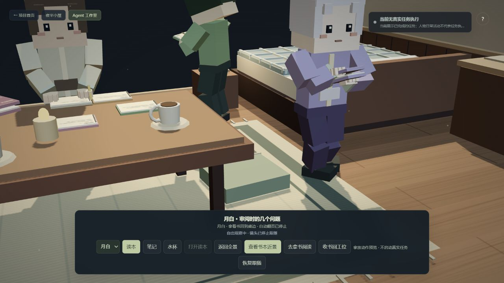

# 人物穿模与穿人排查 · 2026-10-20

## 原因与修复

| 问题 | 原因 | 修复 |
| --- | --- | --- |
| 走动、散场时穿过伙伴 | 寻路只有静态家具，人不是障碍 | 独立动态人物碰撞层，中心间距至少 0.76 个场景单位；移动采用分步碰撞检查，路径随伙伴位置重新规划 |
| 相向而行或堵住取书点后卡住 | 只有停止，没有腾出通道的方法；细小滑动误判为仍在前进 | 检测实际位移进展，必要时侧移、退让并等待，随后继续原目标；让路位置避开来人的目标 |
| 起身、入座时穿人或穿过其他家具 | 原入座过渡直接修改位置，绕过全部碰撞 | 入座、起身、离座也检查人物与家具，只豁免当前实际使用的沙发或办公椅 |
| 白板前人物挤在边柜附近，固定工作人员挡住讨论站位 | 站位未结合身体宽度与现场占用 | 调整前排间距；临时会议避开固定人员、座位、观察者和已预留的站位 |
| 取书时与记录员重叠 | 桃桃的取书点与栗子工位只相距 0.55 | 取书位置移到桌角，面向自己的书，保留约 0.85 的中心距离 |
| 第一人称能直接走入人物 | 玩家只检查家具，NPC 也不感知观察者 | 玩家与 NPC 双向碰撞；生成观察位置时同时避开人物 |
| 手持书时手臂交叉穿进身体 | 书本绕 Y 轴转向读者后，左右抓取点没有同步交换 | 按书本局部坐标与人体左右侧重新映射抓取点；肘部向身体外侧、前方弯曲 |
| 合书携带、放书时道具卡进胸前 | 合书后体积偏向一侧；俯身时仍从旧世界位置放书 | 将合书后的实际体积居中携带；放书开始阶段跟随身体，再连续放到桌面；休息时双手自然放在膝前 |

人物让路不生成任务结果，不修改任务分工；中途腾挪也不被当作到岗确认。书本、键盘、笔记、语音和真实任务记录继续使用原有流程。

## 验证

两分钟待命复现使用 0.05 秒步长，共 2400 帧，包含六人日常活动与真实三维道具，不调用任务模型或语音服务。

| 指标 | 修复前 | 修复后 |
| --- | --- | --- |
| 最近的人物中心距离 | 0.0206 | 0.7656 |
| 人物距离小于 0.70 的角色对帧数 | 195 | 0 |
| 头部、躯干的旋转包围盒相交 | 原逻辑没有检查 | 复现过程逐帧检查，无相交 |
| 活动是否继续 | 会活动，但彼此可穿过 | 六人累计行走均超过 5，仍会阅读、喝水、走动 |

专门回归还覆盖：大位移穿越人物、反复相向交换位置、沙发入座/离座让行、错误椅子目标仍被桌体阻挡、第一人称双向碰撞，以及稳定阅读/打字/书写/休息时前臂和手掌不穿入躯干内部。完整协作与取放书测试也逐帧检查人物间距，保留分工、交接、返工、暂停、停止和讨论恢复检查。

测试入口：`npm run test:traffic`。原 66 项、道具与取放书 18 项、碰撞 7 项、工作台 8 项、实体屏幕 4 项，共 103 项回归；构建与语法检查通过。

页面验证使用「桃桃 → 随身物品 → 去拿书阅读」，检查从桌角取书、携带、入座到打开阅读，保留原任务历史和“当前无真实任务执行”标识。截图来自本机实际浏览器，来源说明见 [assets/README.md](assets/README.md)。

边界：运行时使用人物占地与家具通道约束，并对重点姿态做几何回归；没有引入逐指、逐布料的全物理模拟。测试中的躯干内部检查保留衣袖与肩部正常连接处的接触余量，未将所有网格表面接触都当成穿模。

## 自然避让调整 · 2026-10-20

原避碰解决了穿人，但仍有三个动作问题：碰到之后才处理、动态人物触发整段网格绕路、在让行点固定等待 2.5 秒。人物还会朝无法前进的路径点持续转身，造成原地打转。

现在先判断前方约 1.8 个场景单位内的交会，由固定优先顺序决定一人让路，另一人提前减速。让行点只从可直接走到的邻近位置选择，同时避开伙伴当前路径、后续转弯和最终站位。侧步距离为 0.55–1.15，失败时等待或处理持续堵塞，不用整屋寻路来完成一个侧步。

侧步时保留行进朝向，躯干轻转、手臂收拢、脚步横移；起步、减速和到点停下都有速度过渡，步幅跟随实际移动。静止时不追着路径点转身。持书行走可侧让，正在取放、入座、递交或发言的人不会被突然抢占。

伙伴通过、改派或不再前进后，检查返回路径连续安全约 0.2 秒才恢复；原任务对象与目标坐标保留，让行点不作为到岗确认。恢复路径定期重新检查，持续堵塞仍可调整路线；到岗的相邻人员不会因站得近而被反复叫走。

| 相向交换位置的固定复现 | 原避碰版 | 自然避让版 |
| --- | --- | --- |
| 两人累计行走距离 | 9.02 | 5.76 |
| 第一次作出让行决定时的中心间距 | 没有提前侧让 | 1.735 |
| 最近中心距离 | 原版已有实体约束 | 0.950 |
| 本次交会让行决定次数 | 动态重算路径 | 1 |
| 让行点实际等候 | 固定等待机制 | 0.85 秒，随后恢复 |

复现起终点为 `(-1, -1.4)` 与 `(1.3, -1.4)`，步长 0.05 秒；距离单位为场景单位，表中时间与距离只描述该复现，不是所有房间路线的上限。自然避让版双方 5.95 秒到达原目标，累计转身分别为 0 与 0.606 弧度，单帧速度变化最多 0.13。

新增三项回归覆盖提前减速与侧步、路程与转身限制、让行时保持原目标、伙伴暂停后解除等待、低帧率交会、白板稳定站位；碰撞套件共 10 项通过。另通过原 66 项与取放道具 18 项回归，构建、语法检查通过。完整协作检查仍要求两位人物实际会合后才发出交接语音。

页面的角色标签区分「减速礼让」「侧步让路」「侧身等候」。`#scene[data-state]` 公开诊断含实际速度、侧步量与动作阶段，便于对照画面，而非把角色日常活动计作真实任务。浏览器截图与轨迹保存在 `assets/natural-avoidance/`，没有启动新的任务模型或语音调用。

## 地垫与脚部支撑排查 · 2026-10-20

这次区分了薄地毯和厚坐垫。原来三个厚坐垫只参与绘制，没有行走碰撞；其中两个还与电脑、记录员的工作位置重合。现在地面布局、坐垫尺寸、导航占地和脚部支撑共用 `ground-surfaces.js`：厚坐垫需要绕行，只有正在使用阅读坐垫的人能在入座、起身阶段豁免自己的坐垫。空闲坐垫移至茶几外侧，阅读坐垫略向茶几移动，保留床侧通道；同步调整取书、工作、闲聊和日常活动位置。

旧的阅读脚部检查只测鞋底中心。稳定姿态中，鞋底中心约为 `0.00055`，但实际鞋跟最低点达到 `-0.1185`，已经低于 `-0.025` 的可见地板约 `0.0935`。因此原检查会通过，而画面仍会穿模。

现在测整只鞋的八个顶点，包含鞋尖、鞋跟和侧缘；结合地毯、流苏、坐垫及缝边高度，用三维髋膝踝求解修正接触，兼顾侧步和转向。正常行走提前抬脚避开低矮边缘，落脚修正逐步释放。地垫坐姿改为屈膝、双脚在坐垫前方支撑；起身先用约 0.4 秒抬脚，再收腿起立，阅读时不持续悬脚。浏览器实际稳定阅读的两脚最低点均约 `0.009`，地毯高度 `0.006`，保留约 `0.003` 接触余量。

同类排查还修正了沙发：木制底框向坐垫内部缩进，脚部支撑略向前移，避免坐稳及起身后的第一步把鞋跟压进底框。重新寻路暂时为空时保持等待、重试，只有实际接近原目标才确认到岗，避免人物堵住后在远处开始喝水或工作。

验证使用实际 Three.js 场景网格的包围盒，而非只断言求解器返回值。新增 `npm run test:ground` 的 5 项检查覆盖地毯边缘、流苏、侧步、转身、低帧率、三个坐垫绕行、阅读坐下/起身、鞋跟与沙发底框，以及路径丢失后的到岗真实性。主测试 79 项、地面/道具/人物避让 33 项，共 112 项通过；语法检查和构建通过。

浏览器在原工作室中完成月白阅读及「收书回工位」操作，查看动作与脚部公开诊断；没有提交真实任务或调用语音。实际侧面截图、诊断见 `assets/ground-contact/`。

边界：这是场景尺寸约束与关节动画求解，并非布料、软垫压缩或逐三角形全身物理模拟。接触采用保守的鞋体/地面占地，坐垫角部、流苏间隙会留少量余量；仍保留原有的简化人物碰撞与地面动作。

## 悬空与滑步复查 · 2026-10-20

上一轮只约束鞋不能低于支撑面，没有同时约束落脚高度和支撑期间的位置。平地正常行走的复现中，支撑脚仍高出可见地板约 `0.0432–0.0434`，一次支撑内移动约 `0.0299`。这些数值来自修改前的 600 帧复现，不能用上一轮“不穿入”的结果代替贴地验证。

现在由双脚共同管理步态：支撑脚固定在世界坐标落脚点，另一只脚先抬起、前移、再落地；停止或转身时依次调整脚位。落脚后鞋底对齐实际支撑面，并保留 `0.003` 余量。髋部高度依据腿长、支撑面和脚距调整，呼吸、转向、侧步及俯身不会再把脚带走。慢帧按实际位移分步计算，并把一步结束后剩余的时间用于下一步，避免步幅逐渐落后于身体。

办公椅、沙发先摆好支撑脚再降低身体，起身时落脚点保持固定。地垫起身替换上一轮的同时抬脚预备动作：两脚依次收回到坐垫上，一只脚移动时另一只支撑，摆好后才抬起髋部。回到站姿后，俯身取放书不会因保留的“曾坐过地垫”标记而错误切回地坐姿。站立工作时保持手部与桌面、键盘的接触高度，饮水时手先对准杯位，再把杯沿举至嘴边。

步行落脚避开厚坐垫的保守包围盒空角，避免脚因相邻坐垫而停在空中。完整协作回归暴露的狭窄通道等待也一并修正：新让路动作重新计时，必要时在附近退后让通；动态障碍使粗网格不可达时再采用较细网格，不把原任务改成让路位置。

| 本次检查 | 结果 |
| --- | --- |
| 平地 `.25 / .8 / 1.08` 速度，`1/60 / .05 / .16` 秒步长，共 9 组、每组 4 秒 | 支撑脚最低点离地约 `0.003`，支撑期间最大位移小于 `1e-12` |
| 起步、停止、转身、侧向礼让、坐垫边缘 | 至少一只脚支撑；停止后收脚站稳，不持续原地踏步 |
| 办公椅、沙发、地垫入座与离座 | 检查实际鞋体、落脚点固定和两脚交替；取放书保持连续 |
| 浏览器阅读 → 收书起身 → 行走 → 归还 → 回工位 | 373 条支撑脚记录，离地约 `0.003`，落脚误差小于 `1e-12` |
| 主测试及人物/道具/地面检查 | 79 + 38 = 117 项通过；语法与构建通过 |

可复验脚本：`node scripts/audit-foot-support.mjs`；完整地面检查：`npm run test:ground`。数值和截图保存在 [foot-support](assets/foot-support/measurements.json)，浏览器记录保存各帧原始公开诊断，区分支撑脚与正在抬起的脚，没有把摆动高度计作悬空缺陷。

这些结果描述已覆盖的路径与步长。人物仍是程序化关节模型，没有接入刚体平衡、脚掌软组织或真实动作捕捉；复杂人体重心与全身接触仍是后续改进空间。
