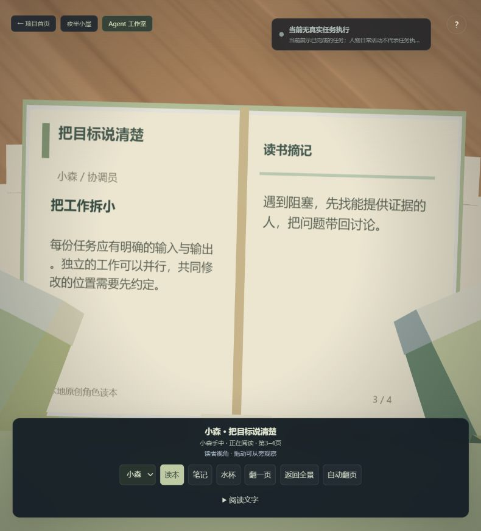
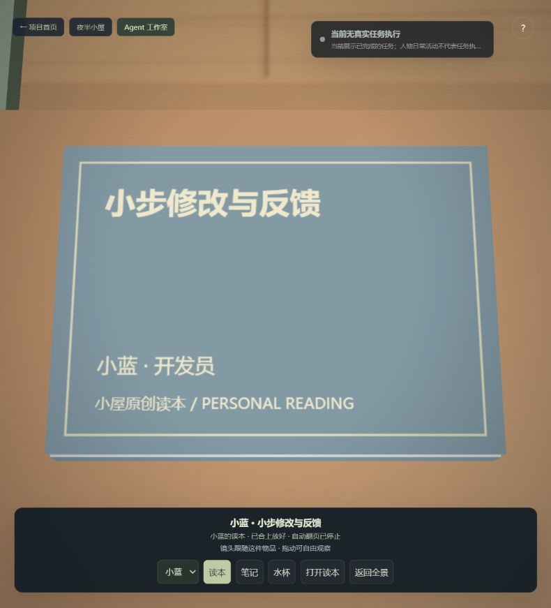
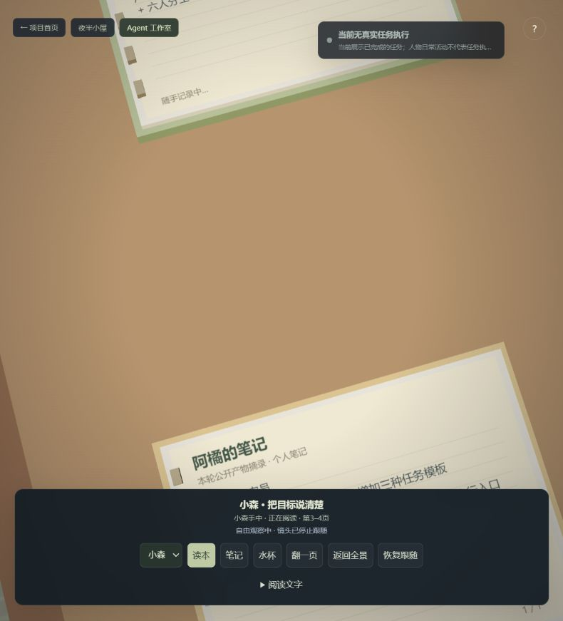
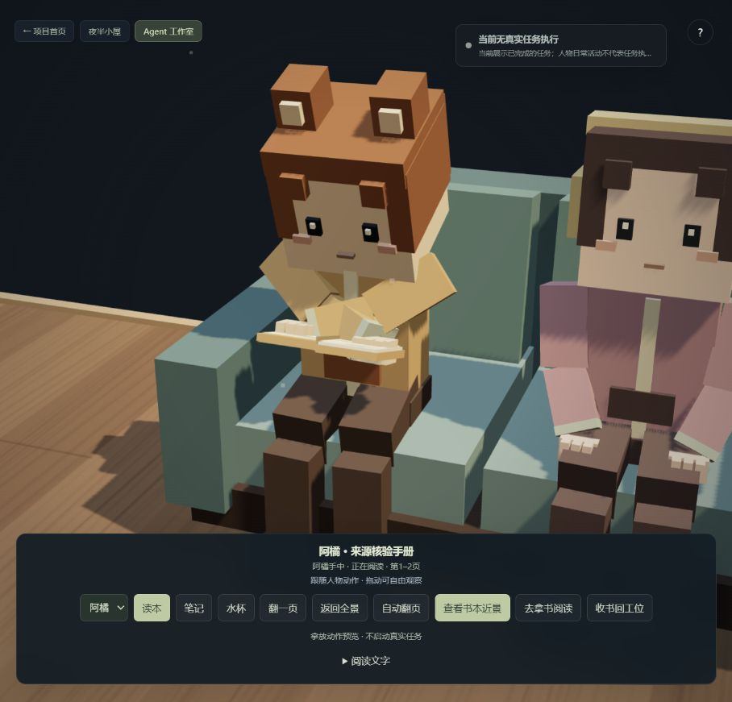

# 房间道具与观察流程审查 · 2026-10-20

范围：当前本机 Agent 工作室的全景、角色读本/笔记近景、手动翻阅、相机跟随和任务卡。使用本轮浏览器截图与实际交互定位问题，保留原有任务历史。

## 发现与处理

| 优先级 | 问题与原因 | 本轮处理 |
| --- | --- | --- |
| 高 | 手持读本按外部相机方向排版，文字顶部靠近读者，人物倒着读；笔记也有相同方向问题 | 手持页面统一面向人物，正文顶部远离读者；近景从读者一侧观察 |
| 高 | 进入近景就触发自动计时，使桌上无人阅读的书也翻页 | 只有实际阅读驱动自动翻页；停放时合上；桌面翻阅必须点击，并明确标为用户手动操作 |
| 高 | 自由旋转关闭相机跟随，但没有状态和恢复入口，容易把别人的道具当成当前角色的书 | 显示自由观察状态，提供「恢复跟随」；标题、物品实体、角色和所在位置对应 |
| 中 | 翻动的一页重复整本双页纹理，反面也不对应下一页；翻页与手部没有关系 | 分别裁取当前右页与下一章左页；翻页带动托书手横向动作；放下时完成翻页并停止 |
| 中 | 近景被头部挡住，角色突然去休息，相机跟着跳回桌面 | 默认读者视角，避免头部遮挡；观察阅读/笔记时暂缓该角色自主休息和新闲聊，真实工作仍可打断 |
| 中 | 窄窗口两套工具栏重叠；任务卡遮住较多房间 | 工具栏独立布局，任务卡跟随容器边界排布；需求与阶段可展开，默认简洁展示 |
| 中 | Canvas 正文不在辅助访问树中，近景自动翻页不利于慢读 | 增加同页文本入口和自动翻页开关；展开文本时停止自动翻页；进入/返回维护键盘焦点 |
| 低 | 封面中缝穿过标题，隐藏页面仍可能被射线命中 | 中缝仅在展开时显示；射线同时检查祖先可见性 |

## 已走查的四步

1. **全景进入角色物品：已改善。** 工具栏不重叠，任务卡可展开/收起。当前窗口实测两栏纵向范围分别为 116–151、158–198 CSS 像素。修改前见 `02-before-overview.jpg`，修改后见下图。

   

2. **查看手持读本：已修复朝向与归属。** 同一实体跟随读者双手，文字正向；读者视角保留双手与书页，可停止自动翻页。修改前 `01-before-reading.jpg` 可见原镜头与所选道具失去对应。

   

3. **查看闲置读本、手动打开与翻页：已修复无人在读却自动翻页。** 闲置书合上，明确显示自动翻页停止；手动打开后说明「你正在手动翻阅」。单页正反面与当前/下一页对应。

   

4. **拖动观察与恢复跟随：已修复反馈缺失。** 拖动后显示镜头已停止跟随，恢复后重新对准所选角色的同一实体。

   

## 验证与边界

原有 66 项测试、道具 9 项、角色工作台 8 项、实体屏幕 4 项回归通过，构建及语法检查通过。新增覆盖文字朝向、唯一书本实体、闲置不翻页、手动单页 UV、停止自动翻页，以及观察保留可被工作动作打断。实际页面验证任务详情展开/收起、手动打开/翻页、自由观察/恢复、文本展开与自动翻页关闭；浏览器未记录 warning/error。

此次没有发起新的 MiniMax/GitHub 开发任务，截图中的任务结果来自既有记录。未宣称完整可访问性达标；手机各种尺寸、屏幕阅读器、对比度仍需专项验收。

## 连续拿放与家具跟进 · 2026-10-20

后续修复将原先按活动状态切换书本位置的逻辑替换为人物持有的动作状态：走到原桌面、俯身伸手、接触后抬起、合书携带、到位后打开；接到工作指令时合书、离座、走回桌边、落桌、松手并收回手臂，再去新工位。书本始终是同一个场景实体，双手接触目标跟随书本，右手随封面的开合弧线移动。中间取放位置不触发实际到岗确认；拿书、行走或归还中改派均采用最新目标。暂停冻结动作，停止保留手中道具，下一次安排再完成收纳。

同类问题一并处理：

| 问题 | 处理 |
| --- | --- |
| 沙发坐垫过高、腿部伸直或穿入坐垫，入座途中旋转 | 坐垫表面改为约 0.465 米；人物骨盆高度约 0.52 米，先面向房间再后退入座，起身先将臀部移向双脚支撑点 |
| 办公椅、沙发、地垫起身过程互相混用 | 保存当前座位信息；分别处理桌椅入座、沙发前移起身与地垫屈腿过渡；离开后才开始普通寻路 |
| 书原先放在沙发扶手、地面等不适合拿取的位置 | 所有书有可通行的桌边接触点；沙发旁新增小边桌，家具碰撞与拿取点共享坐标 |
| 笔记本在桌面和手中切换，旧装饰书堆与笔记重叠 | 笔记本留在实际书写桌面；移除重叠的装饰书堆 |
| 地垫坐姿持书过低，倾斜的书角穿进茶几 | 抬高地垫阅读的持书目标，随坐下/起身连续过渡，并验证整本书的最低点高于桌面 |
| 更换饮水者时不同个人杯在同一位置替换 | 每人从自己的杯位取放；杯子不交换位置，放回后不会凭空增加水量；停止时先完成放杯 |
| 跟随人物转向，相机可能进入书柜或墙体 | 人物动作镜头从房间内部观察，不随人物朝向绕过墙体 |

在「随身物品 → 读本」中提供「观察人物动作」和「去拿书阅读／收书回工位」。这是独立的场景动作预览，不启动真实任务、不改变目标记录；任务运行、暂停或讨论期间禁用预览控制。浏览器走查保留了原任务历史和“当前无真实任务执行”的标识。

验证：原 66 项回归、道具与动作 18 项、工作台 8 项、实体屏幕 4 项，共 96 项通过；构建及语法检查通过。新覆盖六人取书手掌接触、逐帧位置连续、途中任务抢占、暂停、停止后恢复、沙发反复进出、个人杯位、桌面笔记，以及接入道具后的完整分工—交接—返工—交付场景。未将这些动作测试表述为新的模型开发任务。动作使用程序化关节求解与状态过渡，未接入物理抓取或动作捕捉。

后续人物相互穿越、座位通道和左右手抓取的进一步排查见 [COLLISION_AUDIT.md](COLLISION_AUDIT.md)，包含新增的动态人物碰撞和手臂自身穿模回归。
