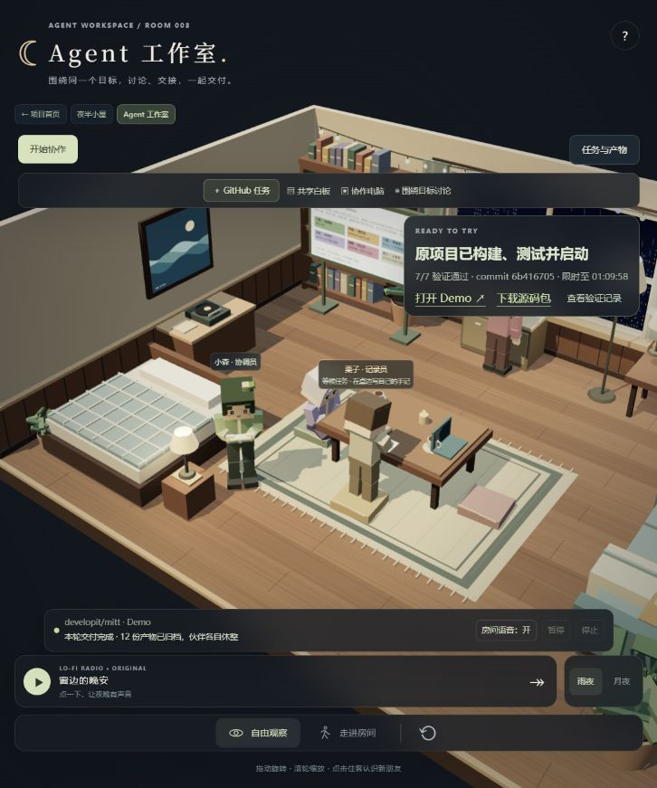
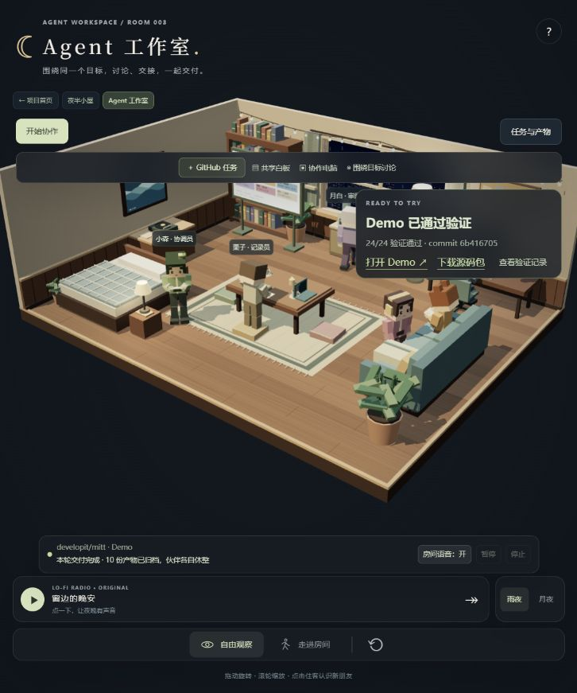
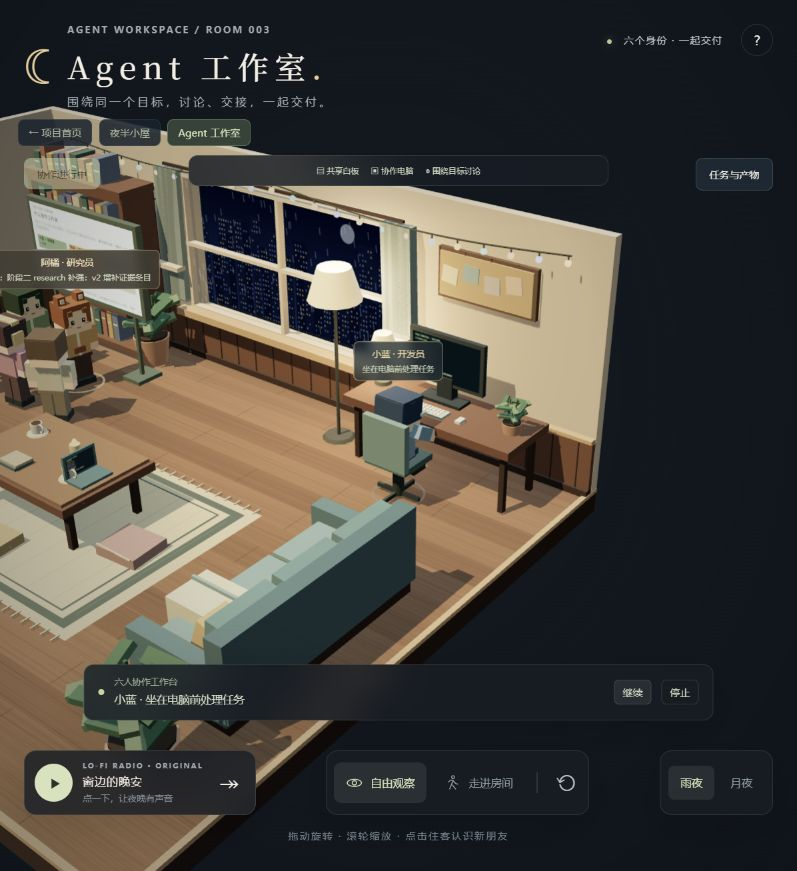

# 003 · 从3D小屋到可接管的Agent工作室

> V1 收录范围（2026-10-20）：整理源码、运行说明、真实验证证据和既有引导图，并接入 GitHub Pages 发布。公开版提供理解摘要、房间及预设协作，真实任务保留本地 Node 服务；线上状态以本项目 `deployment.json` 为准。既有图片中的“未发布/未提交”保留为制图时快照。

## 理解摘要

**来源与能力。** 原帖展示 3D lo-fi 房间、方块人物与动画，作者提及 Three.js、Opus、Midjourney。原场景仓库、固定版本、许可与内部实现尚未确认。已确认的技术上游为 Three.js，提供三维场景、相机、材质、灯光与观察控制；本项目独立实现场景和人物，没有复制原作者资产。

**原理与价值。** 人物绑定协调、研究、开发、审阅、验证和记录身份，后台角色通过结构化产物与工具事件协作；同一任务 ID 将真实执行、人物动作、电脑、白板、语音与交付关联。使用者可以观察进展、定位问题、通过角色工作台介入并核对结果。人物按事件表达工作，不展示模型内部思维过程。

**我们的探索。** 从自由观察与第一人称房间开始，依次探索自然办公/道具互动、六角色语音协作、真实仓库编码、原构建测试、浏览器需求验收、失败讨论返工、后台重连，以及执行中暂停、语音反馈和同任务继续。原始来源、各次失败和修复边界保存在研究与证据记录中。

**达到的效果。** 本地能下发公开 Node.js 仓库任务，固定源码并在独立目录安装依赖、修改源码、运行原 build/test、实际操作 Demo，发现问题后讨论返工，最后交付运行地址、源码和证据。点击人物可查看代码/差异/命令并接管，修改意见转为语音回应和白板方案，点击继续后才回工位执行。外部 mitt 案例、本库真实缺陷和语音接管均有实测；当前仍是有明确边界的研究原型。

**公开与本地。** Pages 运行预设协作、已有 MiniMax 录音、房间漫游和研究阅读；不会调用实时模型或执行仓库。真实模式需要本地 Node 服务、MiniMax 配置和浏览器组件。刷新可重连任务，但服务崩溃不自动续跑；目录执行没有系统隔离，不保证任意仓库都适用。

**可扩展方向。** 优先推进断点续跑、幂等重试、队列与资源控制；再探索受控隔离、MCP/多模型、更多技术栈、角色长期记忆、多人观察与语音输入，最终接入分支/PR/CI、部署和视觉验收。这些方向不计作已实现能力。

已发布并完成公网核验：[理解摘要](https://yydshly.github.io/1014_codex_project/003-lofi-room/research.html#synthesis) · [工作室预设演示](https://yydshly.github.io/1014_codex_project/003-lofi-room/?view=workspace) · [夜半小屋](https://yydshly.github.io/1014_codex_project/003-lofi-room/?view=room)。原引导图SHA一致、63份资源与84个HTTP请求通过；全部15项研究和12个应用入口保留。[发布记录](deployment.json) · [验收范围](assets/publication/README.md)。

把 3D lo-fi 房间变成可观察的 Agent 工作室。六个人物分别代表协调、研究、开发、审阅、验证和记录，任务状态、交接、发言与产物都直接映射到房间里的角色。

**项目理解总览（2026-10-20）**：[一张图查看来源、原理、扩展、探索、当前能力及后续方向](assets/understanding-overview/agent-studio-understanding.png) · [可编辑矢量源图](assets/understanding-overview/agent-studio-understanding.svg) · [来源与验证范围](assets/understanding-overview/README.md)。总览包含三张实际运行截图，明确区分原演示、本项目独立实现与未来规划。

2026-10-20 角色工作台：点击人物可进入其研究、开发、审阅或测试平台，查看实际文件片段、写入差异、命令与退出码；可锁定角色、按任务步骤自动切换，或回看已执行步骤。房间里的开发电脑与测试笔记本分别更新真实内容，执行中才显示活动状态，历史与预设演示另有标识。运行工程为本地研究版本，详情见 [运行说明](web/README.md)。

原仓库任务现增加浏览器功能验收：验证员在独立Chromium会话里按原需求点击、输入和断言，电脑同步真实截图及预期/实际值；用例冻结后，失败回到白板返工并原样重测，通过才交付。控件类型或选项值错误先退回验收规划，不让开发员为无效用例改坏源码；保留用户最终人工体验。首次运行需安装项目的浏览器组件，范围与证据入口见 [运行说明](web/README.md)。

已用本仓库003的「清空草稿」真实任务验证：原构建、72项原测试及三个浏览器场景全部通过，32步页面操作与截图随源码归档，交付页仍等待用户人工体验。功能失败、讨论返工与固定用例重测另由真实浏览器回归夹具覆盖，不冒充MiniMax任务。规划误判、模型错误和取消记录均保留。[验证范围与记录](assets/browser-acceptance/verification.json) · [实际交付源码](assets/browser-acceptance/delivered-source.zip)。

「新目标草稿误归档旧目标」已另用真实MiniMax任务跑出失败与返工：浏览器发现原版归档按钮仍启用，桃桃主动与小蓝讨论；首次修改漏导入又被浏览器拦下，再修复、重测，检查点续跑后由审阅与验证共同通过才交付。原77项测试、新增4项测试及三场景28步操作通过，修复已同步回当前工程；房间可「回看真实返工」，并标明历史回放，不冒充新执行。[真实过程与验证范围](assets/real-browser-repair/verification.json) · [实际交付源码](assets/real-browser-repair/delivered-source.zip)。

本仓库自身任务已实际交付：为003新任务表单增加「功能开发／问题修复／测试补全」模板。使用当前源码的固定本地Git快照，在独立目录克隆、安装、开发、审阅和测试；最终轮原66项测试、新6项模板测试及8项交付检查通过，浏览器逐个验证模板填充、保留仓库配置与手工编辑。五轮历史包含模型中断、工具步数耗尽、真实测试失败与返工；目录TMP路径和执行观察改动由操作者另行实施，最终轮继承已有草稿再验证。[实际交付源码 ZIP](assets/example-own-workspace-task.zip) · [五轮执行与验收记录](assets/example-own-workspace-task.json)。

2026-10-20 统一任务主线：从「＋新任务」填写仓库、具体功能与验收要求，房间常驻任务卡对应展示阶段、人物与实际进展；交付后在同一任务下直接体验成果、对照需求验收、把修改意见交回团队。原仓库下一轮继承已验证源码及固定版本，限时成果可从已有目录重启，无需重做任务。自动测试结果与用户验收分别记录。详见 [运行说明](web/README.md)。

2026-10-19 新增「＋ GitHub 任务」，提供独立离线 Demo 和原仓库执行器。按用户选择，原仓库默认在本机独立目录克隆、安装依赖、修改源码，运行原有 build/test 并启动 Demo，失败日志进入人物交接和白板返工；支持已有构建测试脚本的公开 Node.js 项目。无需 Docker 或云凭据；目录方式以当前用户权限运行，不提供系统隔离。源码、依赖与命令证据按轮保留。配置及验证范围见 [Web 运行说明](web/README.md)。

2026-10-20 原仓库目录方式已验证：真实克隆 `developit/mitt`，固定 commit `6b41670516ed8e8b738612f60491995470aa63b3`（MIT），使用目录内Node20.18.3，修改原项目并运行原有build/test。原19个Mocha用例、类型检查、lint和类型编译检查全部通过，启动了消费真实 `dist/mitt.mjs` 的中文Demo。流程包含202个事件、12份产物和两次返工，其中一次纠正清单工具引起的审阅误判；已修正该工具。浏览器验收另补两行通配状态同步，并再次运行原构建、测试与HTTP验证。[原项目源码与命令证据ZIP](assets/example-original-repository-demo.zip) · [原始协作及复验记录](assets/example-original-repository-run.json)。本机运行地址限时，不登记为公网发布。



独立离线方式另有已验证案例：104个事件、10份产物，24项结构及核心功能检查通过。[离线案例源码包](assets/example-repository-demo.zip) · [离线运行记录](assets/example-repository-run.json)。该方式可直接打开 `index.html`，与上方原项目构建测试分别记录。



原房间与协作页属于同一个编号项目，代码、资产和索引均保留。默认入口恢复为夜半小屋，通过页顶导航进入 Agent 工作室，也能返回项目首页。

- [项目首页](http://127.0.0.1:4175/1014_codex_project/)
- [夜半小屋：原来的观察与漫游](http://127.0.0.1:4175/1014_codex_project/003-lofi-room/?view=room)
- [Agent 工作室：目标、对话与交付](http://127.0.0.1:4175/1014_codex_project/003-lofi-room/?view=workspace)

## 目标与协同空间

「目标看板」可新建、编辑、切换、归档目标，设置最多六条验收要求，并保留最近八轮交付。每个目标关联六位角色的任务、讨论意见、产物依赖与运行历史，数据保存在当前浏览器，可整体导出。

书架前的落地白板显示目标和分工，窗边电脑显示角色进度与共享产物，桌上电脑供验证员检查。点击物体或顶部空间按钮打开详情，补充白板意见；真实模式会在下一轮读取当前验收要求和最近的讨论反馈。交付完成后可以逐条检查要求并确认验收。

默认以房间为主，点击「任务与产物」再展开详情。开工时六人走到白板前；研究员整理资料，开发员绕到电脑椅侧入座打字，审阅员读文档、验证员操作桌上电脑，记录员在桌边归档。交接前会合并面对面说明结果，再伸手递交产物；最后回到白板前汇报。回放等待人物到位并完成工作动作，才展示对应交付。暂停、停止会同时控制走动、工作计时和声音。

人物保留方块造型，姿态按日常办公重新调整：站立时放松肩肘，走路的步幅随实际位移变化；入座与起身逐渐屈伸膝盖，双脚接近地面；打字、托书、写记录和交谈使用不同的肘腕动作。电脑桌、椅子和键盘的位置随人物比例校准，交谈采用小幅手势和倾听点头。

讨论结束后会散场：有任务的人到工位，其他伙伴回到电脑前整理个人资料、桌边写手记、地垫或沙发阅读，也有人坐沙发休息。个人活动不会增加任务进度或生成产物；交接只召集相关两人。临时讨论后参与者返回原工作位置或各自休息，整轮汇报结束后也会离开白板。

待命期间也会自然换动作：有人去窗边饮水角举杯喝水，有人起身伸懒腰或慢走一小段，再回到自己的位置。每个人的间隔不同，同时最多两人离开个人位置，饮水角一次一人。接到任务或被邀请讨论时优先响应；喝水的人先放下杯子，再前往工作位置。启用系统的减少动态效果后，关闭这些自动休息活动。

[查看喝水](assets/workspace-daily-drink.png) · [查看起身伸展](assets/workspace-daily-stretch.png)。

人物也会相互回应：散步路过空闲伙伴时停下、挥手打招呼，休息时找伙伴聊两句，结束后继续原来的活动。互动根据距离、空闲状态和最近的交谈记录触发，同一对伙伴不会连续反复招呼。开发员、记录员开工前会主动核对收到的资料，交接的接收方会当面回应。任务和手动讨论优先，闲聊会让位。

点场景下方「开启房间语音」可听到人物互动；开始协作也会开启可用的房间语音。日常招呼、闲聊和预设交接使用新生成的 36 段 MiniMax 短句，六个角色各有音色；真实模式的工作对齐读出实际交接的任务、标题与摘要，再实时合成语音。它是产物摘要对齐，不额外声称进行了一轮新的模型推理。闲聊不会写入目标产物或冒充工作进度。

[查看沙发上的双人语音聊天](assets/workspace-social-chat.png) · [查看记录员主动核对资料](assets/workspace-social-work.png)。

[查看交付后各自工作与休息的实际截图](assets/workspace-scatter-complete.png)。

[查看新版日常与办公姿态截图](assets/posture-room.png)。

点击人物的「对话」或「围绕目标讨论」，可选择一对一或邀请另一位伙伴。提交问题后文字窗自动收起，人物走到白板前交流；再次打开入口可查看记录。真实角色读取目标与已有产物，依次回应对方，使用 MiniMax 语音播报，嘴部和气泡跟随当前发言。进行中的协作回放会暂停，讨论后手动继续，参与者先返回原工作位置。预设模式明确播放固定讨论。

普通白板便签与交付后反馈作用于下一轮；执行中通过角色工作台接管，可在工具边界暂停并将意见和讨论方案带入同一任务。真实任务在本地后台持续执行，刷新、关闭房间或离开页面后可以接回同一任务、当前人物阶段和遗漏产物；显式「停止」才取消执行。本地 Node 服务需要保持运行，服务重启会将未完成轮次标为中断并保留源码与日志。重新下发时另起一轮，旧记录仍保留。



## 可以体验什么

- **角色与 Agent 绑定**：六个固定身份各有职责、工作位置与 MiniMax 音色；执行时走向工作位置，发言时高亮，嘴部动作跟随音频能量。
- **可追踪协作**：协调员拆分目标 → 研究员整理信息 → 开发员提交方案 → 审阅员与验证员并行检查 → 必要时返工 → 记录员归档。纸张动画表现产物交接，侧栏保留来源、检查结果与完整内容。
- **MiniMax 语音**：六种系统音色，串行播报与同步字幕；支持试听、暂停回放、跳过当前句和停止，人物发言时背景音乐自动降低。
- **两种运行方式**：预设流程包含一次确定的返工，使用十段真实 MiniMax 生成的录音；真实模式通过六个角色 Agent 调用 MiniMax 文本模型，再实时合成各角色结论。
- **可查看交付**：点击人物查看当前任务，点击产物查看全文；导出本轮目标、事件、产物、输入依赖和最终交付编号。
- **房间体验**：保留自由旋转、缩放、第一人称漫游、家具碰撞、雨夜 / 月夜和原创合成 lo-fi 音乐，适配窄屏。关注发言者时视角跟随工作区域，拖动可接管视角；工作室漫游作为独立观察者，六位人物继续工作。

「真实项目」中，离线方式写 Demo 文件并执行 QuickJS 功能测试；原仓库方式修改原项目、执行原有构建测试并启动服务。原「真实 Agent」模式保留文字方案协作，预设模式保留固定效果演示。上方24项检查的mitt案例属于离线方式，不代表原仓库的原有测试；两种运行记录分别保存。

## 本地运行

需要 Node.js **>=22.12.0** 和支持 WebGL 2 的现代浏览器。

```powershell
cd projects/003-lofi-room/web
npm ci
npm run dev
```

打开 <http://127.0.0.1:4175/1014_codex_project/003-lofi-room/>。也可在仓库根目录运行 `./projects/003-lofi-room/web/start.ps1`。

预设流程无需密钥。真实模式需要 MiniMax API Key，由本地服务保管。在 `web/.env.local` 中设置密钥，或引用现有配置文件：

```dotenv
MINIMAX_ENV_FILE=F:/codex_project/.env.minimax
```

该文件需含 `MINIMAX_API_KEY`；支持 `MINIMAX_API_BASE` 或 `MINIMAX_BASE_URL`。实际配置文件被 Git 忽略，密钥不进入浏览器或静态构建。使用真实模式或重新生成录音会调用 MiniMax 服务。

完整配置、检查与部署见 [Web 运行说明](web/README.md)。GitHub Pages 可展示预设模式；真实模式需要本地 Node 服务。线上地址尚未发布，`demo_url` 保持 `null`。

## 来源与固定版本

| 来源 | 版本与使用方式 |
| --- | --- |
| [Three.js](https://github.com/mrdoob/three.js) | `0.186.1`，发布 commit `9b4a2ac29c63ccb43fd51c5661f2f873ac2c39b8`，MIT；使用核心库与 OrbitControls |
| [Vite](https://github.com/vitejs/vite) | `8.3.4`，MIT；构建与本地服务 |
| [AI SDK](https://github.com/vercel/ai) | `ai 7.0.140`、`@ai-sdk/openai-compatible 3.0.68`，Apache-2.0；角色 Agent 与结构化产物工具 |
| [Zod](https://github.com/colinhacks/zod) | `4.6.7`，MIT；校验模型提交的产物 |
| [quickjs-emscripten](https://github.com/justjake/quickjs-emscripten) | `0.32.0`，MIT；在 WASM 中隔离执行生成的核心逻辑，未修改上游 |
| [fflate](https://github.com/101arrowz/fflate) | `0.8.3`，MIT；打包交付 ZIP，未修改上游 |
| [MiniMax](https://platform.minimax.cn/docs/api-reference/speech-t2a-http) | 文本默认 `MiniMax-M3`；语音 `speech-2.8-turbo`，六个系统音色；云服务及录音使用受其条款约束 |
| 视觉灵感：[ゆきち / AI 原帖](https://x.com/fe_yukichi/status/2110271992041750752) | 借鉴 3D lo-fi 房间与方块角色漫游，原作者场景仓库、固定版本与资产许可待确认 |

上游库文件没有修改。房间模型、角色、程序化纹理、界面、背景音乐和协作逻辑独立编写；没有复制原帖图片、视频、模型或音乐。完整依赖锁定在 `web/package-lock.json`，许可原文见 [第三方说明](web/licenses/THIRD_PARTY_NOTICES.md)。

[研究记录与验证证据](RESEARCH.md) · [配图与录音来源](assets/README.md) · [返回总索引](../../README.md)
