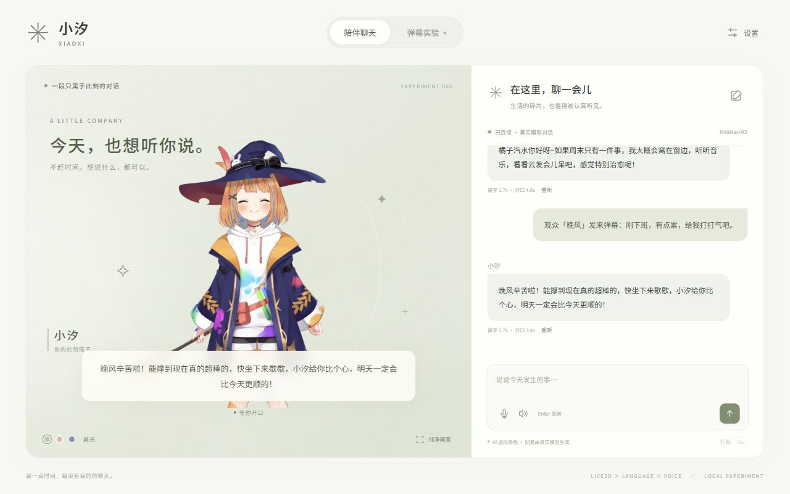

# 005 · 小汐：AI 虚拟角色互动实验

> 远端收录范围（2026-10-19）：本次补交研究文档、来源与证据配图。运行工程和本地复现产物仍保存在本地；下文启动命令与未收录路径记录的是本地研究状态。本项目尚无已验证的公网演示。

目标是复刻原视频中的真人拟人化观感，主线已调整为[实时真人闭环](realtime/README.md)：待机、说话、打断、恢复倾听。当前已有 MiniMax 文字与语音能力，用户尚无实时数字人服务，并要求不下载新模型，因此真人闭环未能实测。已有 Live2D 原型只验证了中文对话、语音、打断和模拟弹幕，没有达到真人目标。此前的[短视频样片实验](samples/README.md)保留为研究记录，不再作为实施主线。



| 信息 | 内容 |
| --- | --- |
| 原项目 | [https://github.com/Open-LLM-VTuber/Open-LLM-VTuber](https://github.com/Open-LLM-VTuber/Open-LLM-VTuber) |
| 固定编号 | `005` |
| 上游参考版本 | commit `992309c0aa19845960228f880013d4685fde93b5` |
| 许可 | 上游代码 MIT；Live2D Mao 模型及 Cubism Core 使用独立条款，见[第三方说明](web/licenses/THIRD_PARTY_NOTICES.md) |
| 研究状态 | 原型已跑通；全本地推理、真实直播平台与麦克风实录待验证 |
| 研究日期 | 2026-10-15 |

## 研究入口

- [研究记录](RESEARCH.md)：问题、复现过程、实现分析与结论。
- [实时真人闭环](realtime/README.md)：现有能力、当前阻塞与真实媒体验收标准。
- [项目图片](assets/README.md)：截图、配图说明及来源。
- [Web 说明](web/README.md)：启动、密钥配置、检查与构建方式。

## 为什么研究这个项目

验证能否用已有模型复刻「赛博小雅」一类能说话、能动、能接住观众话题的虚拟角色。本轮借鉴 Open-LLM-VTuber 的模块分工并使用其固定版本中的官方 Mao 样例，独立实现轻量 Web 界面与 Node 服务；没有将其整套 Python 后端作为运行依赖。

- 中文回复流式展示，完整句子尽早交给语音服务，并在上一句播放时准备下一句。
- 真实 Live2D 角色、自动待机动作、视线跟随与四种表情映射；音频分析驱动嘴型。
- 发送新消息、点击「打断」或按 Esc，停止当前模型生成、语音请求和播放；打断的回答不再作为完整历史发送。
- 支持重听、静音、三种相处风格、主动填写的偏好记忆、聊天记录保留与清空。
- 晨光、暮色、月夜三种场景，以及隐藏聊天栏的纯净画面。
- 模拟弹幕串行回应、暂停、最多 12 条排队；未接入抖音或 B 站实际直播间。
- 可切换本机 llama.cpp / Ollama 兼容服务；本轮仅验证了云端模型，未下载或验证本地大模型。

## 本地运行

需要 Node.js **>=22.12.0** 和支持 WebGL 的现代浏览器。

```powershell
cd projects/005-cyber-companion/web
npm ci
npm run dev
```

打开 <http://127.0.0.1:4177/1014_codex_project/005-cyber-companion/>。也可执行 `web/start.ps1`。角色素材已经保存在项目中，恢复素材时使用 `npm run assets`。

真实模型和优质中文语音需要服务端 MiniMax 配置。当前机器的忽略文件 `web/.env.local` 仅引用已有的 `F:/codex_project/.env.minimax`，没有复制密钥。换机器请参照 [Web 配置说明](web/README.md)。云端调用会发送对应的聊天文字并产生调用费用。

## 截图与演示

截图来自本项目本地运行，来源见 [assets/README.md](assets/README.md)。尚未发布线上演示，`demo_url` 保持 `null`。

实际模型首字延迟约 1.7–3.9 秒；浏览器几次试聊从发送到发声约 3.4–12.3 秒，受网络、模型响应和首句长度影响。这是少量样本观察，不能视为性能保证，尚未达到自然实时对话的稳定低延迟。

## 来源与改动

本项目没有复制原帖视频、声音或人物。角色素材保持上游文件原样；界面、角色加载、语音播放、对话管理、模拟弹幕与测试由本仓库独立实现。对话接入使用 AI SDK；服务端环境配置和 MiniMax 请求方式参考本仓库 `003-lofi-room`，没有跨项目代码依赖。全部素材来源、版本与 SHA-256 见 [asset-lock.json](web/asset-lock.json)。

语音输入由浏览器 SpeechRecognition 提供，可用性取决于浏览器、系统和网络；不属于已验证的本地 ASR，首次使用需用户自行授权麦克风。本轮没有录制真实麦克风，不宣称已完成语音到语音的实录验证。

[返回项目总索引](../../README.md)
