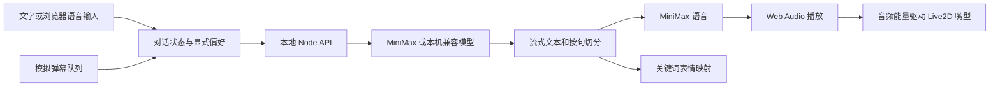

# 005 · 小汐：AI 虚拟角色互动实验：研究记录

## 研究对象

- 灵感：[火山哥介绍的赛博小雅](https://x.com/huoshan007/status/2109919568617484522)。帖子未提供源码，原作者的完整实现、显存配置和收益仍待确认。
- 上游参考：https://github.com/Open-LLM-VTuber/Open-LLM-VTuber ，固定 commit `992309c0aa19845960228f880013d4685fde93b5`。
- 日期：2026-10-15。上游代码为 MIT，Mao 样例和 Cubism Core 独立许可，见 [第三方说明](web/licenses/THIRD_PARTY_NOTICES.md)。
- 本机：Windows、Node 22.15.0、RTX 4070 Laptop 8GB 显存、约 16GB 内存。本轮没有加载本地语言模型，因此不能给出本地推理性能或显存结论。

## 研究问题

用户明确的目标是原视频中的真人拟人化表现。Live2D 只能验证聊天、声音与状态管理，不能据此判定复刻成功。用户已否定以分段生成短视频作为主线，改为直接验证真人的待机、说话、打断、恢复倾听。暂不下载新模型，只使用已有线上能力。

### 真人路线当前状态

已尝试通过现有 MiniMax 配置调用 H3 与 H3 Max：均返回 HTTP 402 / 2068，现有 Token Plan 套餐不支持。没有生成任务或视频成片，没有充值或升级。样片请求、两条路线的边界和复现步骤见[真人样片实验](samples/README.md)。实时数字人候选尚未接入，不声称拥有原帖完整源码或相同效果。

用户随后确认暂时没有数字人相关能力。本轮配置检查只找到 MiniMax，未发现实时人物服务凭据；查阅了 Vidu S2 固定版本的实时会话与打断协议，但未发起真实会话。当前阻塞和验收标准见[实时真人闭环](realtime/README.md)，各项真人表现均保持「未验证」。没有将本地播放取消算作远端人物被打断。

## 复现记录

通过 `python scripts/project_catalog.py add` 创建 005，代码与依赖独立放入 `web/`。复用本机既有 MiniMax 配置文件路径，不读取密钥到前端、不复制密钥进入仓库。角色采用上游原样 Mao PRO 运行文件，所有原文件和 Core 内容已记录来源与 SHA-256。

选择 Vite + Node 本地中间件，避免在第一版引入整套 Python / CUDA 环境。初次运行发现 Vite 对 `%BASE_URL%` 和经典脚本路径发生重复前缀，导致 Core 未加载；改用公共资源根路径后修复。模型在 WebGL 中实际显示并播放待机动作。

pixi-live2d-display 0.4.0 将 gh-pages 4 作为依赖带入，安装审计报告其原型污染问题。应用没有使用该工具，通过 overrides 固定到已避开该问题且未引入另一组 braces 漏洞的 gh-pages 5.0.0；最终 npm 安装审计报告 0 已知漏洞。没有修改上游渲染库。

## 实现分析

- `server/api.js`：服务端保管密钥，输入验证、同源检查、并发限制、超时取消、流式回复与语音内存缓存。兼容模型通过 AI SDK 的已安装版本接口调用。
- `shared/dialogue.js`：中文断句、长度校验、角色提示词、关键词情绪映射、清理失败和打断历史。表情不是模型真实情绪推断。
- `src/main.js`：聊天与弹幕状态、流式消费、本地偏好、输入、打断、场景和角色设置。刷新可保留最近 60 条消息；模型仅获得最近 12 条有效历史和主动保存的偏好，不具备无限或自动长期记忆。
- `src/speech.js`：按句串行合成、播放时预取下一句、Web Audio 能量分析、取消后的世代隔离。MiniMax 音频真实驱动嘴型；浏览器备用朗读采用近似嘴型。
- `src/avatar.js`：PixiJS / Cubism 加载、视线、待机动作、表情映射与音频参数写入；不生成新的动画视频。

## 图片与现象

截图保存在 [assets/](assets/README.md)。桌面在 1280×800 验证，移动尺寸在 390×844 验证；客户端宽度与文档滚动宽度一致，没有横向溢出。手机采用角色在上、聊天在下的布局。截图为真实运行，不是概念效果图。

### 2026-10-15 验证结果

| 边界 | 结果与证据 |
| --- | --- |
| 页面到真实模型 | 已通过。MiniMax-M3 流式返回中文；接口 smoke 首字 2246ms、完成 2485ms |
| 偏好到回复 | 已通过。独立测试中明确保存「阿林、喜欢橘猫」，模型回复「应该叫你阿林，你喜欢橘猫。」；首字 3282ms |
| 文本到音频 | 已通过。问候语生成 MP3 53556 字节，接口报告时长 3240ms；浏览器成功解码播放 |
| 音频到嘴型 | 已通过。播放时页面 voice-level 实测约 0.379，直接用于 Mao 的 ParamA 等嘴型参数 |
| 重听与打断 | 已通过。重听进入「正在说话」，点击打断后变为「等你开口」，打断按钮禁用，队列音频停止 |
| 模拟弹幕 | 已通过。三条评论按次序生成并播报，队列从 2 条降到 0，完成后按钮恢复「开始回应」；三轮首字约 1.7–1.8 秒，发声约 3.4–4.6 秒 |
| 自动检查 | 语法检查、5 项自动测试、生产构建通过；构建有主包约 523KB 的体积提示，不影响本地运行 |
| 输入与密钥 | 无效消息返回 400，跨站 Origin 返回 403，公开配置无 apiKey；UTF-8 字符跨网络块测试通过 |
| 未验证项 | 麦克风实录、浏览器备用音色实际发声、本地大模型、本地 ASR / TTS、真实直播平台和长时间负载 |

接口测试证据保存在忽略目录 `web/.runtime/`；浏览器的延迟数字来自实际发送、首字与 AudioBufferSourceNode 开始播放的时间点。小样本整体首字约 1.7–3.9 秒，发声约 3.4–12.3 秒；单次时间不能代表稳定性能。没有采集用户真实麦克风或克隆真人声音。

## 结论与可借鉴点

已有模型已完成 Live2D 原型中的文字回复与声音交互。第一版的主要工作是状态与取消管理、语音排队和声音到形象的同步。这些结果不能推导出现有模型足以完成真人拟人化目标，实时人物视觉仍是独立的能力缺口。

当前延迟受模型首字、句子边界和在线语音整句合成影响；嘴型只是音量能量映射，未做精确音素对齐。角色外观是 Live2D 官方样例，不是对原帖人物的外观复刻。全本地与商业收益均没有验证依据。

## 下一步

- [x] 记录研究版本、素材和许可证。
- [x] 跑通真实模型、中文声音、Live2D 与模拟弹幕。
- [x] 记录架构、自动检查和真实截图。
- [ ] 接通真实在线人物流，验证待机、说话、打断、恢复倾听；用户暂无相关能力，当前受阻。
- [ ] 按实际媒体观察记录真人嘴型、动作连续性、打断和新问题回应；不再以预生成视频作为主线。
- [ ] 本地量化语言模型、SenseVoice 与 CosyVoice：依用户指示暂缓，不下载新模型。
- [ ] 用户自行授权后验证麦克风对话、外放回声与主动打断。
- [ ] 在选定平台验证弹幕接入、推流和长时间稳定性，再考虑发布。

[返回项目简介](README.md)
