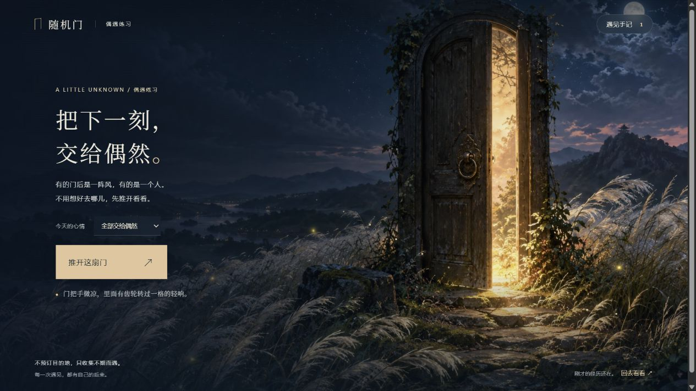

# 006 · 随机门：源库原理、偶遇体验与作品馆

Four-Seasons 用固定种子与季节、时段参数驱动三维场景共同变化；Portal Cube 提供了走进不同世界的入口灵感。本项目区分两件独立作品，借鉴相容变化与稳定状态的方法，探索可连续开门、参与并回访的随机遭遇。

当前已实现连续开门原型：安静、故事、挑战各两处地点，每处有不同的处境、事件或布局。邮局会遇见不同人物与心事，既能随机去下一处，也能留在原处再遇见一次；旧经历留在手记中。情绪变化和回访动机仍待体验验证。

| 信息 | 内容 |
| --- | --- |
| 固定编号 | `006` |
| 项目归属 | [本仓库原创方案](https://github.com/yydshly/1014_codex_project) |
| 概念来源 | [Techartist 的传送门立方体原帖](https://x.com/techartist_/status/2109737086601556195) |
| 场景生成参考 | [Four-Seasons](https://github.com/iamtechartist/Four-Seasons)，固定版本 `23e276eda11e421631df3f4b726a066d59845c91`，MIT |
| 设计日期 | 2026-10-15 |
| 当前产物 | 六处可互动地点、场景内内容变化、连续随机开门与回访、原始脚本及验证记录 |

## 体验连续开门

[打开网页研究总览](http://127.0.0.1:4178/1014_codex_project/006-random-doors/research.html)：对照 Techartist 原帖视频与我们的可互动原型，切换查看四轮演进，汇总随机价值、三种体验、记忆、产品规则和随机作品馆方向。页面明确区分已实现功能、机制示意与扩展设想。

[一张图看完整理解](assets/understanding-overview-20261016.png)（2026-10-16）：区分 Portal Cube 原作灵感、Four-Seasons 独立源码参考与本项目，汇总能力、实现原理、真实效果、三类体验、对我们的价值、扩展方向和验证边界。提供 [可编辑 SVG](assets/understanding-overview-20261016.svg) 与 [素材来源记录](assets/understanding-overview-20261016.sources.json)。

[打开本地原型](http://127.0.0.1:4178/1014_codex_project/006-random-doors/)，需先按 [Web 启动说明](web/README.md)启动本地服务。

保持“全部交给偶然”连续开门，第一轮会遇见六个不同的遭遇。你可能坐在海边等灯、在天台留纸签、陪旅人寄信、替木鸟挑铃、转镜照亮花，或对齐一张星图。每次都可以提前离开，从手记回访时保留自己的回应与进度。

`0.5.0` 将入口和六处地点升级为统一的原画场景，加入六位邮局人物肖像、接雨前景、画面操作点、开门光影过渡与带缩略图的手记。原画由内置 ImageGen 在制作阶段生成，运行时从项目本地加载；随机事件、信件与机关是独立的互动层。

`0.6.0` 增加上述网页研究总览，保留 `0.5` 原型行为。原帖视频使用来自作者 X CDN 的本地研究副本，保留作者、原帖与 SHA-256 记录，已验证可播放；来源见 `web/public/research/source.json`。原媒体版权归 Techartist，未发现独立再许可声明。随机作品馆目前提供三件真实作品的候选抽取示意，实际跨项目进入与跨场景故事回响仍待实现。

[同一场景里的随机内容](VARIATIONS.md) 仍然保留：邮局六位人物、18 条回应与对应后续；候车亭、天台和修补铺各有三种事情，温室有六条可解光路。点“邮局里，再遇见一个人”即可直接比较，不用等六处走完。原来的 [连续开门设计](RANDOM_LOOP.md) 和 3D 候车亭 [旧版说明](web/SEASIDE.md) 继续保留。

`0.7.0` 面向网页发布补足研究摘要、Four-Seasons 能力与原理、访客与创作者的价值，以及高清总览图；原型行为延续 0.5。作品馆真实接入和跨场景因果仍为扩展方向。

## 三种开门体验

两分钟是用于比较的体验长度。实际体验允许提前离开、继续停留或暂时停下，不设置退出倒计时。

| 体验 | 具体场景 | 随机发生在哪里 | 用户进去后能做什么 | 预期情绪变化 | 再次开门的理由 |
| --- | --- | --- | --- | --- | --- |
| [安静停留](experiences/01-quiet-stay.md) | 海边候车亭 | 天气、光线、远处的小变化 | 坐下、看海、接雨、调整视线 | 分心 → 好奇 → 放松 → 余韵 | 看看下一次偶遇的风景，也能回到熟悉的位置 |
| [参与故事](experiences/02-participatory-story.md) | 打烊前的邮局 | 人物处境、明信片内容、后续事件 | 倾听、回应、帮忙投递或告别 | 好奇 → 关心 → 参与 → 牵挂 | 见到另一段人生，或回来看看自己参与过的故事 |
| [完成小挑战](experiences/03-small-challenge.md) | 漂浮温室 | 可解的光路布局、目标植物、完成后的生长 | 观察、转动镜子、尝试、求助 | 好奇 → 困惑 → 理解 → 成就感 | 运用学到的规则，解开下一个有变化的房间 |

三条路线共用“开门、发现、参与、留下余韵”的节奏。它们分别检验：仅有氛围是否足以留住人，影响一个人物是否产生牵挂，以及理解规则是否让随机值得重玩。

## 阅读入口

- [体验比较与共同规则](EXPERIENCES.md)：随机的边界、三种回访动机和后续验证方法。
- [连续开门设计](RANDOM_LOOP.md)：当前六个可互动遭遇及实际随机规则。
- [同一场景里的随机内容](VARIATIONS.md)：人物、心事、事件与布局怎样轮换，旧经历如何保留。
- [研究记录与来源](RESEARCH.md)：可核验的参考、原创范围和待确认问题。
- [项目图片](assets/README.md)：配图与来源登记。
- [Web 说明](web/README.md)：启动、操作方式、依赖与构建。
- [原型验证记录](VERIFICATION.md)：实际浏览器互动与自动检查结果。

## 来源与原创范围

传送门立方体提供了“一个入口通向另一个世界”的概念启发；其随机选取或生成世界的机制待确认。Four-Seasons 提供了可核验的程序化场景参考，具体证据见研究记录。

本目录的体验、虚构人物、对白、谜题和回访规则均为本次新增设计。新版原画来源、文件和最终提示词集见 [素材记录](assets/ART_PROMPTS.md)。连续开门运行时不调用外部图片站或模型服务，保留的 3D 候车亭使用 Three.js。未复制 Techartist 的代码或模型；研究页对照展示原作视频和作者参考图，保留署名、固定来源与媒体权利说明。依赖与媒体登记见 [Web 来源说明](web/public/licenses/THIRD_PARTY_NOTICES.md)。

[返回项目总索引](../../README.md)
