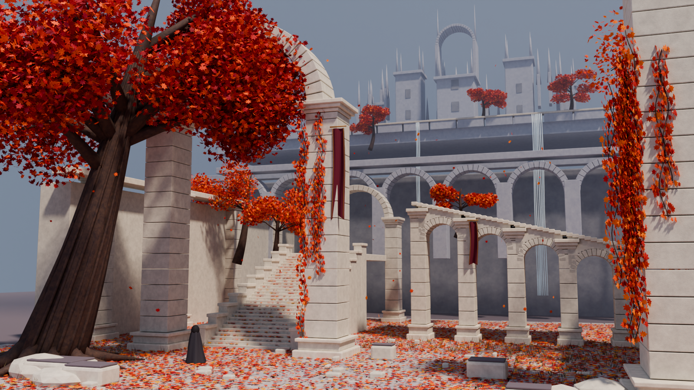

# 007 · 参考图到 Blender：秋日白石庭院

根据 Shikhar 的公开演示画面，用原创 Blender Python 脚本近似重建秋树、白石拱门、台阶、廊桥、瀑布和远处城堡，验证“理解参考图 → 编写建模代码 → 渲染检查 → 修改”的路线。

本实验复现画面主题与空间层次；没有获得原帖对应的场景源码或 Blender 工程，不能将本实验视为作者原始制作流程的完整复现。

| 信息 | 内容 |
| --- | --- |
| 视觉参考 | [Shikhar 原帖](https://x.com/xikhar/status/2110143242591510835)，2026-10-14 演示视频的公开预览帧 |
| 工作流研究对象 | [xikhar/atlas](https://github.com/xikhar/atlas) |
| 研究固定版本 | b283a80dcb6db9068ba368fedfca783f5164ba06 |
| Atlas 许可证 | MIT；本项目没有复制其脚本或安装其技能 |
| 原帖画面许可证 | 待确认，原媒体不随仓库再分发 |
| 本地环境 | Windows、Blender 4.5.9 LTS、RTX 4070 Laptop GPU、Cycles / OptiX |
| 实验日期 | 2026-10-15 |
| 结果 | 已完成可编辑三维场景与实际渲染；属于单图指导下的近似重建 |

## 查看结果

- [主视角高清渲染](assets/render.png)：1600 × 900，Cycles，最多 128 samples。
- [侧上方视角](assets/overview.png)：从保存后的工程重新打开并渲染，检查纵深、遮挡和真实几何。
- [可编辑 Blender 工程](artifacts/autumn-courtyard.blend)：按建筑、树木、地面、雾、灯光和相机分组。
- [完整生成脚本](scripts/build_scene.py)：不下载模型或贴图，不需要额外 Blender 插件。
- [实际构建与渲染数据](assets/render-stats.json)、[工程检查结果](assets/scene-checks.json)。
- [研究过程与局限](RESEARCH.md)、[图片来源](assets/README.md)。

## 做到了什么

程序构造有接缝的石柱、独立拱券、分级台阶和多层露台；树干、根系、分枝、枫叶、落叶、披风人物和旗帜也都有实际几何。石材和树皮使用程序材质，远景加入体积雾。参考图没有作为相机背景、贴图或投影参与渲染。

主要元素及前中后景已建立，但与原图仍有明显差距：建筑装饰较简化，树冠和枝干的形态带有程序重复，落叶分布较均匀，远处城堡、瀑布及光照缺少原作的细节和氛围。单张画面看不到的背面与连接关系由本实验自行设计。

## 本地运行

需要 Blender 4.5 LTS。生成器仅依赖 Blender 自带的 bpy 与 Python 标准库。随机种子固定为 211014；重复执行会覆盖本项目自己生成的同名工程与渲染输出。

在仓库根目录执行 PowerShell：

~~~powershell
$env:BLENDER_BIN = 'D:\codex\tools\blender-4.5.9-windows-x64\blender.exe'

# 960 × 540 的快速检查
& .\projects\007-autumn-courtyard-blender\scripts\render.ps1 -Quality preview

# 1600 × 900 的最终图，同时保存可编辑工程
& .\projects\007-autumn-courtyard-blender\scripts\render.ps1 -Quality final

# 重新读取已保存工程，检查几何并输出侧上方视角
& .\projects\007-autumn-courtyard-blender\scripts\render.ps1 -Review
~~~

请把 BLENDER_BIN 换成实际路径。也可给包装脚本传入 -BlenderPath，或者让 blender 位于命令搜索路径中。没有支持的 NVIDIA 设备时自动回落到 CPU；直接调用生成器并传入 --device cpu 可强制使用 CPU。

工程中保存了一段 1–120 帧的缓慢相机位移，24 fps。当前交付的是静帧；没有导出或验证五秒视频，也没有给树叶、瀑布做动态模拟。

## 对照图

原帖预览帧仅保存在研究机器的仓库外临时目录，不嵌入工程，不加入 Git。可用下列命令把自己取得的参考图与当前渲染拼成带来源说明的本地对照图。此辅助工具需要 Pillow，建模脚本不需要它。

~~~powershell
python .\projects\007-autumn-courtyard-blender\scripts\make_comparison.py --reference 'D:\codex\tmp\autumn-courtyard-reference\reference.jpg' --output 'D:\codex\tmp\autumn-courtyard-reference\comparison.jpg'
~~~

## 来源与范围

- 视觉构图参考原帖的公开视频预览帧；原作品权利归原作者，许可证待确认。
- Atlas 的固定版本用于研究 Blender 脚本路线，未复制其代码。
- 本目录脚本、模型、程序材质及渲染为本次独立编写、生成，没有复制作者原始素材。
- Blender 便携程序来自官方发布目录，保存在仓库外；版本与下载校验见 [environment.json](environment.json)。

[返回项目总索引](../../README.md)
