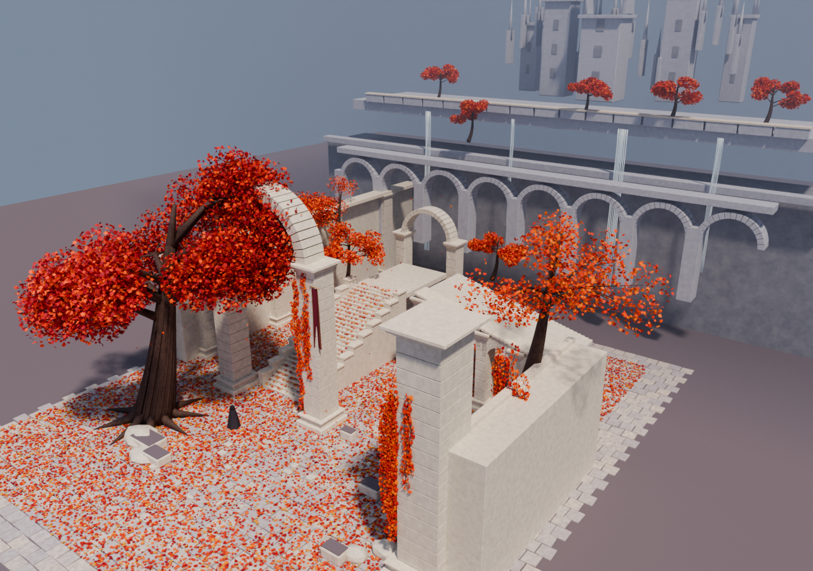

# 007 · 参考图到 Blender：研究记录

最新一轮已改为“先自行生成原创参考图，再用 Blender 脚本重建”，见 [月门水庭实验](original-scene/RESEARCH.md)。下文保留此前参照原帖画面的历史记录。

## 问题与边界

希望验证：不调用专门的图生 3D 模型，只通过理解参考画面并编写 Blender 脚本，能否做出具有相近主题和空间层次的可编辑场景。

参考是 [Shikhar 原帖](https://x.com/xikhar/status/2110143242591510835)的视频预览帧，1200 × 675。它是一张已经渲染完成的画面，不是原作者的初始概念图。原场景工程、原提示词、相机参数及制作记录均未取得。

作者公开的 [Atlas 固定版本](https://github.com/xikhar/atlas/tree/b283a80dcb6db9068ba368fedfca783f5164ba06)，commit b283a80dcb6db9068ba368fedfca783f5164ba06，MIT 许可证，支持图生 3D 工具、Blender 脚本和程序几何三种路线。本次独立试验脚本路线，未安装该技能包，也未复制其中代码。

## 参考画面拆解

| 层次 | 观察到的元素 | 本次处理 |
| --- | --- | --- |
| 左侧前景 | 倾斜大树、粗根、深红树冠、白色落石 | 管状网格与根系、纵向树皮棱、成批枫叶网格、白石 |
| 中央主体 | 白色高拱门、分块石柱、层叠柱脚与柱头 | 独立石材层、楔形拱券、边缘倒角 |
| 中景 | 上升台阶、落叶、长旗、披风人物 | 独立踏步与踏鼻、散布叶片、带褶皱的旗帜与披风 |
| 右侧 | 近景大石柱、垂藤、斜向连续小拱廊 | 柱脚与接缝、叶片藤蔓、阶梯露台及拱廊 |
| 背景 | 高台、瀑布、秋树、尖塔与空心拱冠城堡 | 多层建筑、细条水流、简化树木、城堡轮廓与体积雾 |
| 整体 | 暖秋叶、冷空气、白石、深浅分层 | 程序材质、暖太阳、冷环境光、仅覆盖后景的雾 |

尺寸、相机和不可见部分依靠视觉估计。没有执行自动深度估计、多视角匹配、相机标定或真实三维扫描。

## 实现方式

生成器从空场景开始，使用 Blender 自带 API：

1. paving：批量创建石板轮廓和板间缝隙。
2. architecture：创建石柱、拱券、台阶、廊桥、柱脚、落石和支撑结构。
3. background：创建后方露台、拱廊、细条瀑布、塔楼与尖顶。
4. tree / Leaves：生成管状枝根，把有分叶轮廓的枫叶批量合并为网格，避免数万个独立物体。
5. vegetation：创建树冠、藤蔓、地面落叶、少量悬空叶片和草。
6. atmosphere / camera：设置暖太阳、冷补光、后景体积雾与固定主视角。
7. render_setup：优先 OptiX，其次 CUDA，否则 CPU；使用 Cycles 渲染。

所有材质由颜色、噪声、凹凸和透光节点组成，没有外部贴图。人物仅用于比例与构图，是简化披风形体，不是完成的角色资产。

## 实际迭代

| 阶段 | 实际图像 | 发现与处理 |
| --- | --- | --- |
| 第一版 | [01-blockout.png](assets/iterations/01-blockout.png) | 主要物体已出现；石块面朝向写反，光照偏灰，主拱门偏小，树冠过稀 |
| 第二版 | [02-composition.png](assets/iterations/02-composition.png) | 修正面朝向、放大并前移拱门、加密树冠；雾仍覆盖近景，小拱廊近乎侧对相机 |
| 第三版 | [03-lighting.png](assets/iterations/03-lighting.png) | 将雾限制到后景，调整光照，改变小拱廊方向，补尖塔和藤蔓 |
| 最终版 | [render.png](assets/render.png) | 增加树皮棱、左侧围廊、白石与落叶；补台阶顶部平台；高清输出并保存工程 |

保存后重新检查工程时，发现四个柱子顶端因浮点余量产生的薄石块高度为负。已在生成器中跳过不足 0.04 m 的残余石层，重新生成工程和最终图，再执行检查。

这是观察渲染后定向修改脚本的过程，没有建立自动打分、自动修改的无人值守循环。

## 环境、性能与检查

- Blender 4.5.9 LTS，官方 Windows x64 便携版；SHA-256 已与官方校验文件匹配。
- Windows，NVIDIA GeForce RTX 4070 Laptop GPU，Cycles / OptiX。
- 最终图 1600 × 900，最多 128 samples，开启自适应采样与降噪。
- 随机种子固定为 211014。
- 构建、渲染耗时及几何数量见 [实际运行数据](assets/render-stats.json)。这些耗时只代表一次运行，不包含写代码、分析图片和前几轮迭代。
- [review_scene.py](scripts/review_scene.py) 从已保存工程重新读取，检查有限坐标、封闭石块体积符号、相机和图片依赖，再从侧上方渲染。[实际检查结果](assets/scene-checks.json)。

检查通过只说明工程可读取、所检查的几何条件有效，并能从另一角度渲染；不代表拓扑达到游戏量产标准或与参考图准确匹配。当前场景针对离线静帧，尚未进行实时引擎优化。

## 结果与差距

已经验证：通过编写普通 Blender Python 代码，可以完成一个具有真实遮挡、阴影、材质和相机纵深的近似场景。保存后的工程不依赖模型推理即可再次渲染。

当前仍明显弱于参考画面的部分：

- 树木：分枝、树皮和树冠团块仍带有规则感，缺少自然变化。
- 建筑：轮廓和层次基本成立，但墙体、装饰和城堡过于简化。
- 材质：石材老化、苔藓、局部色差和接触细节不够丰富。
- 构图与光照：台阶、廊桥、城堡的位置比例只是近似；明暗分配和空气感未准确匹配。
- 自然细节：瀑布是简化细条几何，叶片散布较均匀，未做风场、水流或落叶动画。
- 单图约束：不可见背面和建筑连接无法据此确认，由本实验补建。

没有给出“相似度百分比”；当前没有定义可靠度量或开展独立评估。这是可查看、可修改的概念场景实验，不是准确的单图三维重建。

本实验支持参考图指导下的代码建模能够落地大体构图和三维层次。进一步接近原图，需要改善几何造型、素材细节、布局和美术判断；提高渲染采样数本身不能解决这些问题。

[返回项目简介](README.md)
