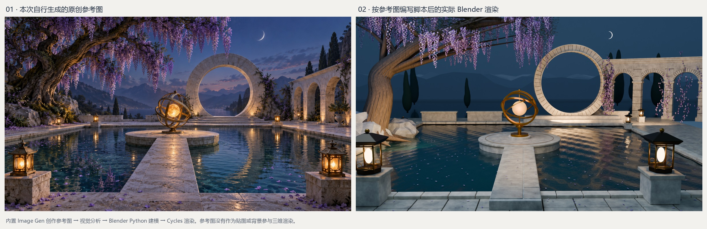

# 月门水庭：自己生成图片，再用 Blender 脚本重建

本次主题为原创的暮色水庭：紫藤大树、圆形石门、水中圆形小岛、黄铜天球仪、暖色灯笼及三孔拱廊。参考图通过内置 image_gen 生成；从画面出发独立编写 Blender 脚本，没有采用原作者的图片或工程。

## 成果

| 文件 | 内容 |
| --- | --- |
| [concept.png](assets/concept.png) | 本次先生成的原创参考图 |
| [image-prompt.txt](image-prompt.txt) | 生成图片使用的完整英文提示词 |
| [render.png](assets/render.png) | 实际 Cycles 高清渲染 |
| [comparison.jpg](assets/comparison.jpg) | 左参考图、右实际渲染 |
| [overview.png](assets/overview.png) | 重新打开已保存工程，从侧上方渲染 |
| [demo.mp4](assets/demo.mp4) | 五秒演示：2 秒参考图、2 秒三维环绕、1 秒最终主视角 |
| [moonwater.blend](artifacts/moonwater.blend) | 可编辑三维工程 |
| [moonwater-web.glb](artifacts/moonwater-web.glb) | 同一工程的压缩网页模型，可在网页内旋转缩放 |
| [export_web.py](scripts/export_web.py) | 合并网格、转换材质并导出网页模型 |
| [web-export.json](assets/web-export.json) | 源工程哈希、实际几何数量与导出记录 |
| [build_moonwater.py](scripts/build_moonwater.py) | 完整建模、程序材质、灯光和渲染代码 |
| [scene-checks.json](assets/scene-checks.json) | 对保存后的工程实际执行的检查结果 |
| [render-stats.json](assets/render-stats.json) | 实际物体数量、分辨率、设备和运行耗时 |
| [provenance.json](provenance.json) | 参考图生成方式、哈希及代码来源 |

## 本次原理

1. Image Gen 根据提示词生成独立的二维概念图。生成时没有输入图片。
2. 由模型观察概念图，估计池塘、圆门、桥、小岛、树和相机的位置与尺寸。
3. Python 脚本用普通几何操作构建网格、材质节点、灯光和相机。
4. Blender 运行代码并实际渲染；观察结果后修改构图、光照和细节。
5. 保存工程，重新读取后渲染侧视图与相机环绕，再组合成演示视频。
6. 重新读取同一工程，合并网格并导出 GLB，用 Three.js 在网页内实时显示、旋转、缩放和平移。

圆门由独立环形石块构成；天球仪为相互倾斜的金属带和发光球体；紫藤为树干、分枝、叶片和成串花朵的网格；池水由带轻微起伏的网格与反射材质组成。参考图不作为相机背景、材质或投影输入。

## 运行

在仓库根目录执行 PowerShell。将 Blender 路径替换为自己的安装位置。

~~~powershell
$env:BLENDER_BIN = 'D:\codex\tools\blender-4.5.9-windows-x64\blender.exe'

# 快速预览
& .\projects\007-autumn-courtyard-blender\original-scene\scripts\render.ps1 -Quality preview

# 高清图与可编辑工程
& .\projects\007-autumn-courtyard-blender\original-scene\scripts\render.ps1 -Quality final

# 重新打开工程，检查并渲染侧视图与 24 帧环绕
& .\projects\007-autumn-courtyard-blender\original-scene\scripts\render.ps1 -Review

# 拼接对照图和视频，需要 Pillow 与命令搜索路径中的 ffmpeg
python .\projects\007-autumn-courtyard-blender\original-scene\scripts\make_media.py
~~~

建模与渲染只需要 Blender 4.5 LTS 自带 Python；没有额外建模插件或在线模型服务依赖。生成器固定随机种子 151026，重复执行会更新本实验自己生成的工程和输出。未找到支持的 NVIDIA 设备时回退到 CPU。

视频里的花朵和水面是静态几何，只移动相机，没有实现风场或流体模拟。相机环绕帧位于被 Git 忽略的 .cache 目录，最终视频保存在 assets。另已追加 [网页三维查看器](http://127.0.0.1:4175/1014_codex_project/007-autumn-courtyard-blender/#scene)，导出、构建与依赖见 [网页说明](../web/README.md)。

## 结果边界

主体构图和元素能够落地，但参考图更丰富的树皮、自然枝形、雕刻、天空云层、灯笼装饰和细腻水波仍未准确匹配。本实验没有做深度估计、相机标定或多视角重建，所有尺寸和不可见结构均为视觉估计。

[研究与迭代记录](RESEARCH.md) · [返回项目入口](../README.md)
