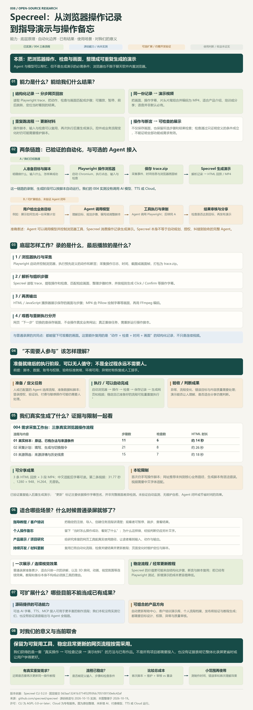

# 008 · Specreel：从浏览器操作，到指导演示与操作备忘

**Specreel 把 Playwright 浏览器操作记录加工成分步网页回放和视频。可以由外部 Agent 调用模型准备流程、调用浏览器工具执行，再交给 Specreel 生成演示；准备就绪后的执行、采集和生成阶段，可以无需人逐步点击或剪辑。** Agent、模型和聊天软件内置浏览器都不是核心链路的必需条件。

我们已用 004 需求采集页面的三个实际流程生成原生与中文两套回放、视频。它对我们的意义是保留“怎样操作、看到了什么”的可重跑记录，按需用于指导、备忘和项目展示。其潜在增量在重复生成与更新；一次性展示时普通录屏通常更直接，当前没有总体省时或学习效果提升的对照证据。

| 信息 | 内容 |
| --- | --- |
| 原项目 | [specreel/specreel](https://github.com/specreel/specreel) |
| 固定编号与版本 | 008 · 0.2.0 / commit `0d3aa13241b3714f32f93fdc705100150e6c42af` |
| CLI 许可证 | AGPL-3.0-or-later；上游 Cloud 属专有代码，本项目未运行 |
| 实测与整理日期 | 2026-10-15 实测；2026-10-19 归纳对话、核读固定源码、整理研究网页与原创总图 |
| 已验证范围 | 脚本录制、HTML 回放、MP4 导出、中文适配、输入改变后重跑及更新标记 |
| 源码支持、未实测 | MCP / Agent 接入、自然语言流程生成与验证修复、AI 旁白、TTS、Cloud、上游 CI 工作流 |
| 发布状态 | 2026-10-19 已通过 Actions 发布并完成公网核验，见 [部署记录](deployment.json) |

## 查看研究网页与实际结果

- [正式理解汇总](https://yydshly.github.io/1014_codex_project/008-specreel/#synthesis) · [实际效果](https://yydshly.github.io/1014_codex_project/008-specreel/#results) · [一图总结](https://yydshly.github.io/1014_codex_project/008-specreel/#overview-map)。
- [理解汇总网页](web/index.html)：能力、原理、Agent 组合、自动化边界、实际成品、录屏对比、使用场景与当前取舍。
- [原生 / 中文比较入口](web/demo.html)：切换流程与生成模式。
- [中文采集计划分步回放](web/zh/02-search-plan/demo.html) · [对应 MP4](web/zh/02-search-plan/demo.mp4)：同一份真实记录；视频 31.77 秒、1280 × 948、H.264、无音轨。
- [原生单文件演示合集](web/native/gallery.html)：三条流程及其保存画面。
- [一图总结 PNG](assets/specreel-understanding.png) · [SVG 矢量版](assets/specreel-understanding.svg)：同一张原创总结图。
- [研究与实验记录](RESEARCH.md) · [2026-10-15 验证数据](artifacts/verification.json) · [固定来源和哈希登记](artifacts/sources.json)。

## 原理、效果与边界

主链路为：**目标与操作脚本 → Playwright 启动浏览器、执行和记录 → trace.zip → Specreel 解析事件、匹配画面、生成字幕与步骤 → HTML / MP4 / GIF。**

固定版本还有 MCP 工具、Agent 技能与 `nlflow` 等可选接入。Agent 可以组织模型与工具协作；Playwright 才是真正执行网页点击和输入的工具，Specreel 本身负责加工记录。已有 trace 的核心渲染可以离线运行，不必再启动浏览器，也不必调用模型。

“无人参与”适用于准备就绪后的执行阶段：脚本、环境、账号权限、数据与成功标准明确后，可以连续操作、检查、采集和生成。首轮目标定义、授权、验证码、异常恢复、分享范围和结果验收仍可能需要人；我们没有证明任意网站、任意任务全程零人工都能可靠完成。

HTML 的播放、暂停与下一步只控制保存的画面；再次办理真实业务需要重跑脚本或操作原网站。检查通过只覆盖预先定义的条件，更新徽标也不保证检测全部画面变化。

## 使用场景与当前取舍

| 场景 | 可提供的价值 | 需要另外完成的工作 |
| --- | --- | --- |
| 指导演示、客户培训 | 让别人逐步看到入口、动作与结果 | 选有意义的流程、调整节奏、检查是否看懂 |
| 个人操作备忘、团队交接 | 保存当时怎样做、看到了什么 | 补任务背景、选择理由、经验与责任说明 |
| 产品介绍、GitHub 项目研究 | 用真实运行过程说明能力 | 关联版本、来源与限制，确认内容适合分享 |
| 持续开发、教程更新 | 复用自动检查与操作记录，重跑后生成新材料 | 维护脚本、数据与账号，处理页面变化 |
| Agent 网页任务回顾 | 探索给工具执行留下可播放的记录 | 串联执行工具、授权、隐私、恢复和验收；完整闭环未测 |

候选产品包括操作档案、随版本更新的帮助中心、Agent 任务回放、客户验收演示包，均需补充产品能力和需求验证。当前保留为可复用工具，稳定且反复更新的网页流程按需采用；不要求所有项目接入。

## 本地查看与复现

查看已经保存的演示只需在本项目目录运行 `npm run serve`，打开其输出的本地地址，不需要启动 004 或调用模型。重新录制时再按 [004 Web 文档](../004-jasonzhu-ai/web/README.md)启动目标页面。安装、构建与录制步骤见 [Web 运行说明](web/README.md)。

## 来源、许可证与改动

- 原始固定引擎：[上游源码](https://github.com/specreel/specreel/blob/0d3aa13241b3714f32f93fdc705100150e6c42af/specreel.py)；站点附 [未经修改的固定引擎](web/vendor/specreel-0d3aa13.py)及 [AGPL-3.0-or-later 许可证全文](web/vendor/SPECREEL-LICENSE.txt)。完整上游快照可由 `scripts/download-upstream.ps1` 取得，`upstream/` 不进入静态站点。
- `scripts/capture.mjs` 为原创录制与检查脚本；本地 trace 位于忽略提交的 `captures/`。`scripts/build.py` 复用固定引擎，适配中文字幕、播放器文案与 CJK 视频字体，没有调用模型改写或 TTS。
- `web/native/` 是固定引擎直接生成的结果；`web/zh/` 由同一记录和中文适配生成。研究网页、交互说明、比较入口及 `scripts/build_understanding.py` 总图脚本为本项目新增；图像来源见 [配图登记](assets/README.md)。
- 截图来自本仓库 004 原创页面，外部引文沿用 004 的来源说明；本次沿用既有实测，没有新执行外部搜索、模型分析或 Agent 任务。

[返回项目总索引](../../README.md)
