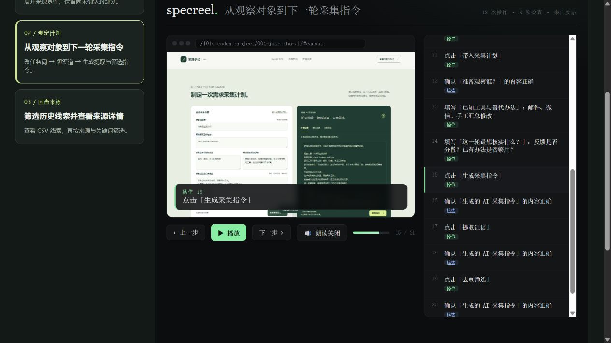

# 008 · Specreel：004 需求采集页面演示生成实测

> 远端收录范围（2026-10-19）：本次补交研究文档、来源与证据配图。运行工程和本地复现产物仍保存在本地；下文启动命令与未收录路径记录的是本地研究状态。本项目尚无已验证的公网演示。

已用 004 页面的真实操作生成三条可交互演示和三段 MP4，保留原生结果与中文适配版。对当前研究库，它适合保存可重复执行的操作导览；首轮仍需要定义流程、检查结果和处理中文显示。

| 信息 | 内容 |
| --- | --- |
| 原项目 | [specreel/specreel](https://github.com/specreel/specreel) |
| 固定编号 | 008 |
| 固定版本 | 0.2.0 / commit 0d3aa13241b3714f32f93fdc705100150e6c42af |
| CLI 许可证 | AGPL-3.0-or-later；上游 Cloud 标注为专有代码，本轮未运行 |
| 实测对象 | 004 需求发现与采集页面，2026-10-15 的本地构建与保存样本 |
| 研究状态 | 已复现录制、生成、回放、MP4 导出与更新标记；AI 旁白与语音未测 |

## 查看实际结果

- [本地实测入口](http://127.0.0.1:4188/1014_codex_project/008-specreel/)：选择流程，比较原生生成与中文适配。
- 原生单文件演示合集：`web/native/gallery.html`（本地路径，本轮未收录）：包含三个流程，可以从本地直接打开。
- 中文采集计划演示：`web/zh/02-search-plan/demo.html`（本地路径，本轮未收录）：由同一份实际操作记录生成。
- 中文 MP4：`web/zh/02-search-plan/demo.mp4`（本地路径，本轮未收录）：约 32 秒，无音轨，可以保存。
- [研究记录](RESEARCH.md)：实测步骤、限制与对你的价值。
- [验证数据](artifacts/verification.json)：步骤、检查、视频规格、文件大小与输入文件哈希。

## 本地复现

先按 [004 Web 文档](../004-jasonzhu-ai/web/README.md)启动 4176 服务。本项目使用 Node.js 22、Python 3.10、Playwright 1.62.1、Pillow 11.3.0 和 FFmpeg。安装与生成命令见 [Web 说明](web/README.md)。

本地服务仅监听 127.0.0.1:4188。演示未发布，根索引 demo_url 保持空值。

## 来源与改动

- 固定版本上游 ZIP 在本地忽略提交的 upstream/ 下；可用 scripts/download-upstream.ps1 重新取得，没有修改快照。
- scripts/capture.mjs 为本轮原创录制与检查脚本；captures/ 保留本地实际记录。
- scripts/build.py 独立适配中文字幕、单流程播放器和视频字体，没有调用 AI 改写或 TTS。
- web/native/ 是上游 CLI 直接生成的结果；web/zh/ 使用同一份记录与中文适配生成；web/index.html 是原创比较入口。
- 截图来自本仓库 004 原创页面，外部引文沿用 004 的采集说明；本轮未执行独立搜索 API。
- artifacts/recommended-flows.mjs 保存原生网址推荐脚本的语法错误诊断，未将其计作运行成功。

[返回项目总索引](../../README.md)
