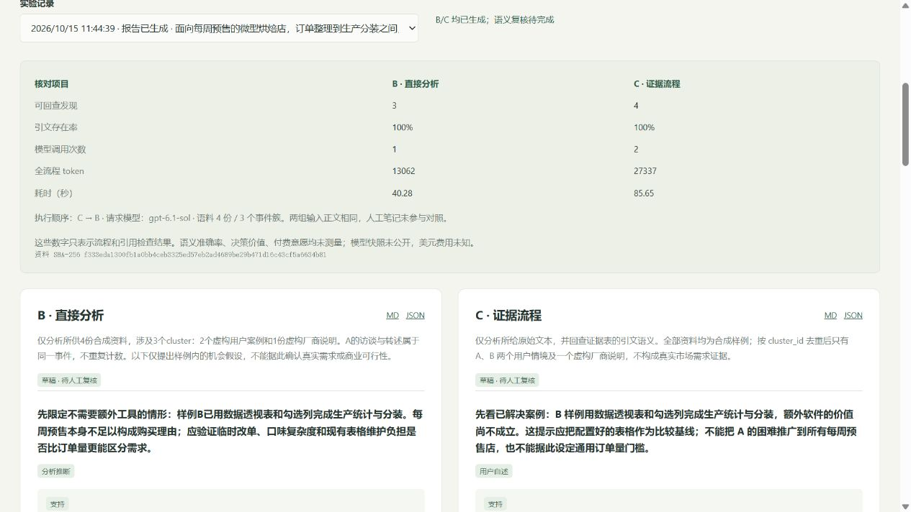

# 010 · 从 Atypica 到数据驱动的需求调研

完整整理 2026-10-15 至 2026-10-19 的讨论：从 X 帖子、Atypica 的研究价值，走到 B/C 最小版本、停止实验，再到真实数据、身份记忆、娱乐社区、传统 NPC 与开放式玩法。编号和目录保持 010 不变。

本项目的研究摘要：

- **源产品能力**：Atypica 期望通过资料研究、用户视角模拟、需求洞察和研究报告，辅助用户与市场调研；其私有实现和独特效果待确认。本项目研究的是产品方法，没有取得或复现其完整服务端源码。
- **使用场景**：个人开发者、创业者和产品团队寻找需求、整理反馈、比较现有方案、评估产品假设，形成可回查的研究判断。
- **我们的实践与理解**：实现资料导入、证据整理和报告原型，以同模型、同合成资料完成 B/C 对照，流程可运行但额外收益未获证明。身份引导视角，模拟提供假设，研究判断需要现实依据。
- **引发的思考**：结果来自模型、数据、角色还是流程？最终收束为“数据是产品调研的事实基础 → 证据整理 → 需求判断 → 产品验证 → 反馈沉淀”，用支持、反证与实际结果校正解释。
- **可扩展方向**：需求雷达、调研工作台、证据回查与报告、经验检索和领域助手。角色社区与娱乐玩法保留为历史分支；新实践暂不推进，真实需求和付费均未验证。

**当前状态：理解汇总与归档；原 B/C 实验、新项目实践和行动工作台暂不推进。** 合成资料试跑只证明流程能运行，未证明研究增益、真实付费需求或 Atypica 的效果。真实数据采集、人设模拟、AI 社区、游戏原型、真人评价、留存与付费验证均未执行。

## 当前理解 · 2026-10-19

**数据是产品调研的事实基础；证据、判断与反馈让它支持产品决策。** Atypica 期望将资料研究、用户视角模拟和报告组织起来辅助需求调研；其私有实现、独占数据和独特增益仍待确认。我们的概念拆解是：以模型为基础，结合相关数据、角色约束、证据流程与真实验证来组织研究。

从具体问题出发，获取和沉淀有出处的资料，整理支持、反证和未知，形成需求判断，再验证和实现产品。实际使用、结果和成本反馈回来，修正资料与判断。基于这条链路可以构建需求整理、证据回查、研究报告与验证管理等产品，也可扩展到变化观察、经验检索和特定场景助手；价值需要用真实任务收益验证。

[打开网页中的理解总览](http://127.0.0.1:4184/#synthesis)。下图是原创概念总结，不是 Atypica 架构图、当前页面截图或效果证明。

图源与生成方式见 [配图说明](assets/README.md)；[SVG 原件](assets/understanding-map.svg) 和 [结构化内容](data/understanding-map.json) 同时保留。

我们区分两条路线：研究工具辅助客户需求调研，依靠真实资料、证据和真人验证；娱乐型 AI 世界依靠人物、共同历史、选择与后果，是否好玩需要体验验证。娱乐社区是后续设想，不能当作 Atypica 的已核实功能。

身份和记忆可以支持不同角色，但人物真实体感不等于预测真人准确。传统 NPC 也可以有记忆、目标、关系与动态剧情；大模型新增多少玩法，取决于自由表达能否形成可执行、有代价、后果不同的有效策略，而不是生成多少台词。

完整主题记录见 [DISCUSSION.md](DISCUSSION.md)，由 [专题内容源](web/archive/journey.mjs) 与 [问题库](web/archive/content.mjs) 构建。它涵盖入口、思考、已做事项、数据处理、产品分支、验证方法和核心问题；不是逐字聊天转录。原有设计、来源、报告和停止决定保留。

讨论中曾提出[研究与行动工作台规格](http://127.0.0.1:4184/#action-plan)：七步工作流、五类页面、六种关联对象、七天试用与实施顺序。用户已决定先不关注实践，这些方案保留为历史设想。010 旧实验的[完整历史记录样例](data/research-action.example.json)可在材料库下载；新编辑系统和试用均未实现或执行。网页现有一张理解总览图、7 个专题、28 个问题、34 条来源、24 份材料。

## 统一网页入口

启动后打开 [010 研究与思考档案](http://127.0.0.1:4184/)。同站编号入口为 `/1014_codex_project/010-evidence-research-lab/`。在项目总索引中找到固定编号 010，即可定位本目录。

网页阅读顺序：

1. [一张图理解总览](http://127.0.0.1:4184/#synthesis)、[完整理解与阅读入口](http://127.0.0.1:4184/#understanding)、[研究入口与演进](http://127.0.0.1:4184/#origin)。
2. 七个专题：[研究价值](http://127.0.0.1:4184/#research-value)、[身份与记忆](http://127.0.0.1:4184/#identity-memory)、[真实数据](http://127.0.0.1:4184/#real-data)、[娱乐社区](http://127.0.0.1:4184/#community-design)、[NPC 与玩法空间](http://127.0.0.1:4184/#npc-gameplay)、[扩展与核心问题](http://127.0.0.1:4184/#extensions)、[流程产品与行动](http://127.0.0.1:4184/#action-plan)。
3. [完整问题库](http://127.0.0.1:4184/#discussion)、[来源目录](http://127.0.0.1:4184/#sources)、[实际 B/C 报告](http://127.0.0.1:4184/#experiment)。
4. [完整材料与 HTML / Markdown / JSON 导出](http://127.0.0.1:4184/#materials)。

原实验工具保留在 [B/C 工作台](http://127.0.0.1:4184/workbench/)。浏览归档不调用模型。

`npm run build` 生成 `web/dist/index.html` 和本目录 `DISCUSSION.md`。CSS、脚本、总览图、来源、研究材料、合成资料试跑及历史截图嵌入同一 HTML，可离线阅读和完整导出。Markdown 保留总览文字，JSON 另保留图源、SVG 原文和哈希；PNG / SVG 可直接下载。构建只读取明确列出的文件，不打包 `.runtime` 或私人资料，不运行模型。公开部署采用仓库 GitHub Pages，目标编号路径为 `/1014_codex_project/010-evidence-research-lab/`；发布状态和公网核验以 [deployment.json](deployment.json) 为准。本机 B/C 工具不随静态网页发布。

以下为前期工具的历史运行截图：

| 信息 | 内容 |
| --- | --- |
| 固定编号 | 010 |
| 实现版本 | MVP v0.1.0，2026-10-15，Asia/Shanghai |
| 项目性质 | 原创设计；研究 Atypica 的方法，不宣称复现其私有模型或数据 |
| 本仓库 | [yydshly/1014_codex_project](https://github.com/yydshly/1014_codex_project) |
| 首个领域 | 微型烘焙商家的订单整理、生产汇总与分装工作流 |
| 产品使用者 | 为该领域寻找产品机会的个人开发者、产品顾问 |
| 真人研究对象 | 实际负责订单的店主或员工，与产品使用者分开 |
| 研究状态 | 已归档；本轮停止探索，实际增益未验证 |
| 与 009 的关系 | 009 本地研究保留平台地图和方法，未纳入本次发布；010 实现资料与证据研究流程 |

## 保留的最小版本

输入一个明确的产品决策、目标人群和资料，输出最多 6 条发现的决策简报：用户的问题、当前办法、现有产品、证据支持的缺口、冲突和下一步验证。

首轮支持粘贴、TXT、Markdown、JSON 导入。人工卡片可定位到原文；B/C 公平对照重新从原文分析，不读取人工笔记。不加入人设模拟，不输出未经测量的市场占比。

## 阅读入口

- [MVP.md](MVP.md)：用户、范围、交互、核心流程和验收。
- [本地运行说明](web/README.md)：启动、导入格式、模型、数据存储与限制。
- [真实模型流程试跑记录](evaluation/bc-smoke-result.json)：合成资料，不是效果或商业需求验证。
- [完整合成试跑快照](data/bc-smoke-archive.json)：全部输入、B/C 结果、引用、11 份原始提示 / 输出 / schema / Markdown 文件；明确排除其他私有运行。
- [DATA.md](DATA.md)：来源准入、去重、证据、真人资料与留出数据。
- [EVALUATION.md](EVALUATION.md)：四组对照、公平预算、盲评与继续标准。
- [IMPLEMENTATION.md](IMPLEMENTATION.md)：模块、接口、运行边界与实施顺序。
- [SOURCES.md](SOURCES.md)：原始链接、固定参考版本与许可证。
- [RESEARCH.md](RESEARCH.md)：完成情况、设计判断与未验证假设。
- [资料登记](data/source-register.json)：6 条候选链接，尚非实验语料。
- [实验配置](evaluation/experiment.json)、[12 个开发问题](evaluation/briefs.json)、[真人场景题模板](evaluation/holdout-questions.template.json)、[评分表](evaluation/ratings.csv)。
- [四组提示词](prompts/arms.md)、[报告接口](contracts/report.schema.json)、[研究输入示例](data/study.example.json)。

## 验证框架

下表保留完整研究路线；本次仅实现 B、C。A 的联网和 D 的人设模拟没有执行入口。

| 组 | 方法 | 解释 |
| --- | --- | --- |
| A | 同一模型直接联网调研 | 整体产品相对现有做法的增益 |
| B | 同一模型直接读同一份冻结资料 | 排除数据覆盖差异 |
| C | 同一资料 + 结构化证据与反证流程 | 研究工程的增益 |
| D | C + 数据约束的人设模拟 | 模拟本身的增益 |

模型、总预算、问题和报告上限一致。B/C/D 禁止联网，底层资料相同；C/D 的整理、画像和模拟费用全部计入成本。

**D 没有超过 C，就关闭模拟；C 没有超过 B，就暂停扩展。** A 的差异单独解释为整体效果，不用来证明模型推理更强。

## 当前使用方式

需要 Node.js ≥22.15 和已登录的本机 Codex。无第三方依赖，无需新建 API 密钥。

~~~powershell
cd projects/010-evidence-research-lab/web
npm run dev
~~~

打开 [研究归档](http://127.0.0.1:4184)。如果需要查看原有工具，进入 [/workbench/](http://127.0.0.1:4184/workbench/)。归档页面不需要模型登录或调用；工具中的模型运行会消耗账户用量并发送正文。详细配置和检验命令见[运行说明](web/README.md)。仅本地展示，未发布线上演示。

仓库根目录检查：

~~~powershell
python scripts/project_catalog.py sync
python scripts/project_catalog.py check
~~~

未复制 Atypica 服务端代码，也未导入其公开数据集；固定版本与非商业许可见 [SOURCES.md](SOURCES.md)。原创文件未另行声明独立许可证。

[返回项目总索引](../../README.md)
