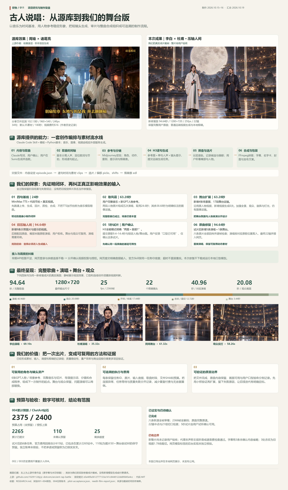

# 古人说唱：我们的理解、探索与下一步

源库的价值是把多个生成服务组织成可检查、可替换的视频制作流程。我们的探索说明：**演唱视频要以原曲音频约束表演，人物图约束身份，分镜约束摄影，再按同一歌曲时间轴剪辑。** 只生成画面、最后配回歌曲，不能据此得到对应原曲的口型。

上图沿用2026-10-19已生成的原图，PNG为3600×6120，保留[SVG](assets/ancient-rap-battle-research-overview.svg)与[图源清单](assets/ancient-rap-battle-research-overview-sources.json)。图中“未发布公网”是制图当时的状态，当前发布记录另行维护；真实视频比静帧承担更多验收要求。

## 库的效果与能力

研究对象为 [ancient-rap-battle](https://github.com/10291124jcjc-dotcom/ancient-rap-battle)，固定到 [`e5e40fa3612777133a141c8448122dd0fd45e4cc`](https://github.com/10291124jcjc-dotcom/ancient-rap-battle/tree/e5e40fa3612777133a141c8448122dd0fd45e4cc)，代码采用MIT许可，原文见[许可](licenses/UPSTREAM-MIT.txt)。上游作者为10291124jcjc-dotcom／硅基废话。

作者的周瑜×诸葛亮示例约102秒；本项目保留的分享版实测960×540、24fps。作者记录约16美元视频生成费，这是历史个案，不能当作现价、总成本或效果保证。网页中原作与我们的作品分别署名。

源库由Claude Code Skill、创作模板与10个Python脚本构成，连接选题、歌词、歌曲、参考图、逐句视频、质检与包装。原版歌曲由用户在Suno生成，8张参考图由用户在Midjourney生成；脚本向MiniMax H3提交人物图、单句人声及镜头提示。音频处理与转写生成歌词时间，候选素材经选择、偏移和剪辑表进入FFmpeg合成。默认分镜请求27条说唱和8条过场，共35条、180秒素材，并非每秒都会用于最终视频。

它没有训练自己的音乐、图片或视频模型。Skill提供操作协议与决策顺序，模型提供生成能力，脚本维持文件和时间轴；选歌、挑图、审片和预算仍依赖人。默认768P素材后期输出1080p，也不等于原生生成1080p细节。[源码分析与证据](RESEARCH.md)、[来源登记](SOURCES.md)保留具体依据。

## 我们做过什么

| 阶段 | 实际探索与效果 | 得到的判断 |
| --- | --- | --- |
| 001：24秒基线 | MiniMax TTS加代码节拍，四条真实视频；原始音轨QA失败记录保留 | 配音加节拍需要明确标识；音轨检查不是口型验收 |
| 002：《敬风霜》整曲 | 用户提供63.28秒歌曲，重新定制人物，两条视频组成五次演唱，其余明确为图像运镜 | 完整歌曲时长与真实表演素材量分别统计 |
| 003：舞台扩充 | 四张新舞台图、观众反打和灯光剪辑，沿用002表演，未新增视频调用 | 场景更丰富，但静图运镜不等于新的动态舞台视频 |
| 004：视觉样片 | 统一人物图，生成动态演唱、舞台与观众；没有提交原曲音频，后期配歌 | 用户拒收口型；说明输入流程存在关键缺口，不能以成片导出替代演唱质量 |
| 明确音频的小样 | 普通视频“两图＋音频1”，原曲9.4–14.4秒，用户确认“口型已可用，继续修整片” | 这条原片支持音频驱动路线，结论仅限已确认的小样 |
| 整片修复 | 新增5条演唱和1条舞台视频，同任务ID续查取得结果，按原曲对应时段重剪 | 94.64秒新片已导出并展示，整片带声验收尚未完成 |

当前成片为[《压轴人间》原曲驱动舞台版](web/public/media/repaired-film-004/ya-zhou-ren-jian-audio-driven.mp4)：94.64秒、1280×720、25fps、22镜；对应原曲人物演唱40.96秒，观众20.08秒，其余为开场、收尾、舞台和无脸细节。完整歌曲不裁切、不变速，仅一次−1.5dB响度调整及不足一帧尾静音；最终画面没有变速或静图运镜，没有调用MV功能或本地口型生成模型。

人物从同一双人主定妆图派生单人和舞台参考，再生成观众、服装细节；形象为虚构成年演员的艺术设定，并非历史人物真实肖像。演唱素材明确提交人物图、舞台图、对应原曲WAV及提示，剪辑位置与驱动音频使用相同歌曲区间。舞台、观众和无脸细节可以复用，旧版不合格的可见演唱不放回有声演唱段。

新片SHA-256：`97a08f79cdeba756fb35280652445343be25219b2cc1ded532e3c62e3ccad4a6`。真实制作范围、分段与预算见[公开记录](web/public/data/004-repaired-film.json)；5秒小样及用户确认见[小样记录](web/public/data/004-h3-audio-pilot.json)。文件解码、原曲完整性与切口抽查已完成，不能据此宣称整片逐音素准确或已获用户整片通过。

004授权上限2400钻；累计已记录任务2265钻，未确认尝试预留110钻，敞口2375钻，剩余25钻。修复阶段6条任务回报615钻已包含在累计金额中。未独立核对账单；001—003历史费用不重复计入004。整理和静态部署不新增生成费用。

## 对我们的价值与引发的思考

1. **能力要分层验证。** 套餐、授权、网页连接属于接入层；图片与音频被正确识别属于输入层；嘴形、人物稳定和美感属于成片层。某个入口失败，不能直接推出远端模型无能力；入口可调用，也不能推出作品可用。
2. **以音频为主线组织创作。** 原曲不是合成时随意铺上的背景音。表演驱动、歌词时段、演唱者和剪辑表需要共享时间基准。图片负责身份，提示负责镜头，声音负责可闻表演约束。
3. **小样是制作前置条件。** 同曲、同角色、同一输入方式的短片通过后再扩大。短片确认和整片确认分别记录，避免把一次成功外推成稳定批量能力。
4. **一致性与舞台感来自资产及编排。** 统一定妆派生参考有助于减少漂移；远景、近景、双人、观众和细节随歌曲段落推进。仍需逐镜检查人物、服装、空间和情绪是否连续。
5. **可恢复比反复重跑更有价值。** 保存任务ID、输入清单与哈希，断线先续查、不要重扣；素材有稳定编号，失败可以局部替换。状态应区分已提交、待返回、已下载、已检查、被拒收及获确认。
6. **检测结果需要注明证明范围。** 音轨相关可以帮助检查声音是否保留，全段解码可以发现损坏；两者都不能证明口型、情绪或剪辑品质。人工带声审片仍是重要质量关口。

本次沉淀的是角色参考、带音频的分镜、模型接入经验、可追溯素材、预算约束、剪辑表与失败原因。它们有望降低下一次组织和返工成本；尚未做对照研究，不能声称已证明节省比例、商业收益或受众偏好。

## 可以扩展的方向

| 方向 | 预期价值 | 下一步验证 |
| --- | --- | --- |
| 角色与舞台资产库 | 固定参考、服装与场景版本，跨集复用 | 同角色在近景、侧脸、双人和不同灯光下的身份稳定度 |
| 音频优先分镜 | 歌词段落、演唱者、驱动WAV与剪辑位置联动 | 语速、停顿、轮唱与伴奏间奏的切片可靠性 |
| 输入能力明确的模型适配 | 区分音频参考、音频驱动、原声输出与只生成画面 | 使用同一段歌词和同一人物做受控比较，核实入口实际传参 |
| 可恢复任务队列与预算账本 | 续查、防重、局部重做、保留未确认金额 | 超时恢复、重复执行及失败任务计费 |
| 候选对照审片与局部重剪 | 原声、参考图、结果和切口同屏审核 | 独立审片人发现缺陷的速度、误判和返工范围 |
| 质量与成本基准 | 按可用演唱秒数、重做率、身份稳定度比较 | 相同输入重复生成，避免用单条最佳样片比较 |
| 系列内容与创作工作台 | 诗词舞台、角色对谈、知识短剧或品牌角色 | 观众接受度、可负担性、内容准确性及授权条件 |

这些是建议与假设，尚未实现为自动产品。静态网页展示已有结果，不会代读者调用模型或扣费。公开仓库保留研究和制作代码、精选证据及展示媒体；运行环境、模型缓存、账号配置与大体积制作中间文件留在本地，完整生产归档路径不代表文件已全部随网页发布。
