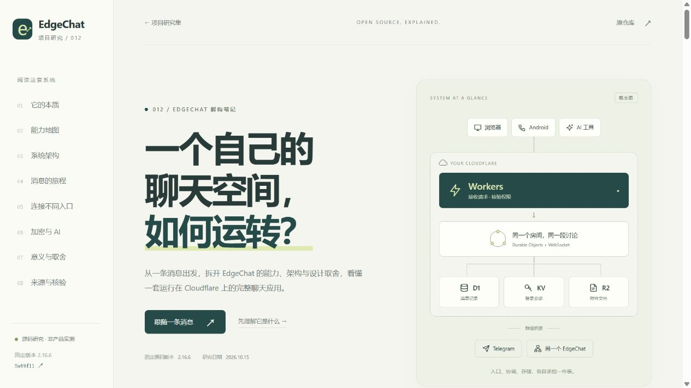
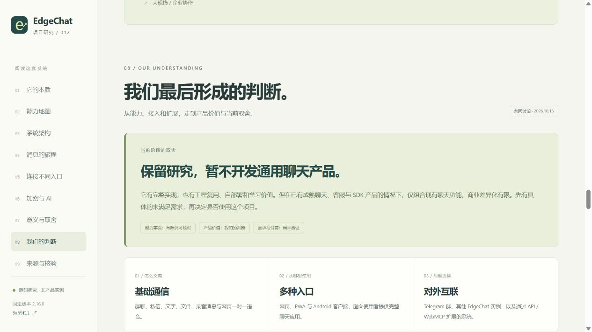

# 012 · EdgeChat：自部署聊天系统原理研究

EdgeChat 原本交付一套可自部署的聊天应用：成员能群聊、私信、发送文件与录音，网页支持一对一实时语音，并可按限定范围桥接 Telegram 群和其他实例。底层通过 Cloudflare 的接口、实时协调、数据库与文件存储组成一个实例。

它让我们进一步思考：通信、使用入口、跨系统互联怎样组成完整系统，以及“能扩展”为什么不等于“值得做产品”。对我们的价值是学习架构、保留自部署候选方案，并在真实项目有明确需求时评估工程复用。研究的意义也包括知道哪些事情已有成熟方案，避免仅为增加聊天功能重复投入。

可扩展客户交付协作室、页面反馈、Telegram 支持台、AI 任务协作室、嵌入式 SDK 与多人音视频，但均需新增业务能力并验证需求。**当前保留研究，暂不主动开发通用聊天产品。** 本轮部署的是中文研究展示网页，上游聊天后端仍未部署实测。

| 信息 | 内容 |
| --- | --- |
| 原仓库 | [aozorae/Edgechat](https://github.com/aozorae/Edgechat) |
| 固定版本 | `2.16.6`，提交 [`5a69f11ef0b2bdbdee611620af0f438c68d90f1e`](https://github.com/aozorae/Edgechat/tree/5a69f11ef0b2bdbdee611620af0f438c68d90f1e) |
| 研究日期 | 2026-10-15（Asia/Shanghai） |
| 摘要整理 | 2026-10-19（Asia/Shanghai）；沿用原总结图，固定源码版本不变 |
| 上游许可 | README 声明 GNU GPL v3.0 or later；LICENSE 为 GNU GPL v3 正文 |
| 研究状态 | 网页与源码分析已完成；上游云端部署、真实桥接、通话与性能待实测 |
| 本地技术栈 | 原生 HTML / CSS / JavaScript；Node.js 构建与预览，无第三方依赖 |

## 打开展示页

在本项目的 `web/` 目录运行：

```powershell
npm run dev
```

默认地址是 `http://127.0.0.1:4182/1014_codex_project/012-edgechat/`。同一服务的 `/1014_codex_project/` 提供项目总入口，读取根索引、配图和已构建的子项目。具体命令见 [Web 说明](web/README.md)。

公开入口：[理解摘要与研究网页](https://yydshly.github.io/1014_codex_project/012-edgechat/#synthesis) · [一张图总览](https://yydshly.github.io/1014_codex_project/012-edgechat/#summary-overview) · [产品方向与当前取舍](https://yydshly.github.io/1014_codex_project/012-edgechat/#understanding)。2026-10-19 经 GitHub Actions 发布并完成公网核验，记录见 [发布验收](deployment.json)。部署的是静态研究页，上游聊天后端仍未部署实测。

也可直接打开构建后的 [离线单文件网页](web/dist/standalone.html)，无需启动服务即可阅读与操作演示。

## 展示内容

**引导图沿用我们已生成的总结图**：[PNG 原图](assets/edgechat-summary.png) · [SVG 矢量版](assets/edgechat-summary.svg)。首页预览原图上部，点击展开完整长图；保留原始字节，未重新生成。覆盖源库能力、效果、底层架构与流程、能力边界、网页嵌入、六类产品假设、价值与当前取舍，离线单文件内嵌图片。

网页先用六项理解摘要回答原始效果、原理、引发的思考、我们的价值与意义、产品方向和当前取舍，再进入九章详细研究。

1. **本质**：使用者、部署者、开发者三个视角。
2. **能力地图**：八项能力，可筛选、展开原理和边界。
3. **系统架构**：点击 Vue、Workers、DO、D1、KV、R2 查看职责。
4. **消息旅程**：文字、附件、Telegram 回流、语音四条路径，支持逐步浏览与自动播放。
5. **桥接对比**：区分 Telegram 媒体互通和跨实例文字投递。
6. **加密与 AI**：解释静态加密信任模型及五个 WebMCP 操作入口。
7. **意义与取舍**：结合四种具体场景判断价值和前提。
8. **共同理解与产品判断**：梳理嵌入网页的开发缺口、六类扩展假设与成熟市场下的实际价值。
9. **来源核验**：18 处固定版本来源，可按主题和路径搜索。

## 共同理解与产品判断

EdgeChat 的本质是一套完整聊天应用：底层实现文字、群聊、私信、文件和语音消息，上层提供网页、PWA、Android 等使用入口，并通过 Telegram 桥接、实例互联和 API / WebMCP 连接其他系统。网页一对一实时语音已有实现；群语音、视频会议和 Android 通话不在当前通话实现范围内。源码存在仍不等于已经完成部署实测。

把它封装成网页内聊天组件是可开发的方向，需要继续处理嵌入界面、网站账号与会话权限、业务对象与房间的对应关系、稳定接口和后端部署。完整应用已有多个入口，不代表任意网站或软件都能一键接入。

客户交付协作室、页面反馈模块、Telegram 社区支持台、AI 任务协作室、通用聊天 SDK、多人音视频，都是技术或产品假设；是否有人需要、是否愿意付费尚未验证。成熟产品已覆盖许多类似需求，因此新增一个聊天框或 AI 入口通常难以独立构成产品优势。比较参考包括 [Chatwoot](https://www.chatwoot.com/features)、[CometChat](https://www.cometchat.com/chat-and-messaging) 与 [Canny](https://canny.io/features/portal)。

本轮共同判断是：**保留原理研究，暂不主动继续开发通用聊天模块或新产品，等真实项目出现明确需求后再比较方案。** 通用聊天产品的商业差异化有限，不等于这个库没有价值；自部署、特定场景的工程复用和学习其通信架构，仍有实际意义。这是当前阶段的取舍，后续可以根据需求和实测调整。完整分析见 [研究笔记中的共同理解与产品判断](RESEARCH.md#9-共同理解与产品判断研究判断)。

## 实际截图



截图来自本子项目实际运行页面；示意消息不是真实用户聊天记录。



## 研究与来源

- [完整研究笔记](RESEARCH.md)
- [固定版本来源清单](research/upstream.json)：原始文件的 HTTP 状态、字节数与 SHA-256。
- [截图与原创配图说明](assets/README.md)

本项目原创编写中文说明、HTML/CSS/JS、架构图与交互流程，引用上游文档和源码作为事实依据；未复制上游应用代码、界面、品牌图像，也未修改上游。图标为原创内联 SVG。

本页不访问 Cloudflare、Telegram 或真实 EdgeChat 后端。事实、研究判断与待实测项分别标记；源码存在不能直接作为实际性能或可靠性已验证的证据。

[返回项目总索引](../../README.md)
