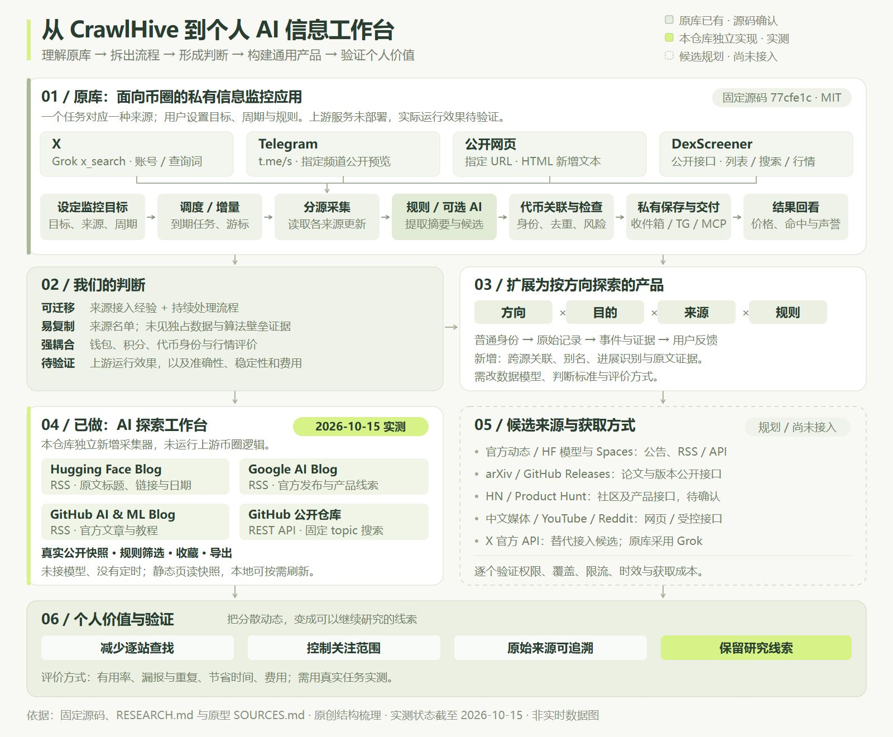
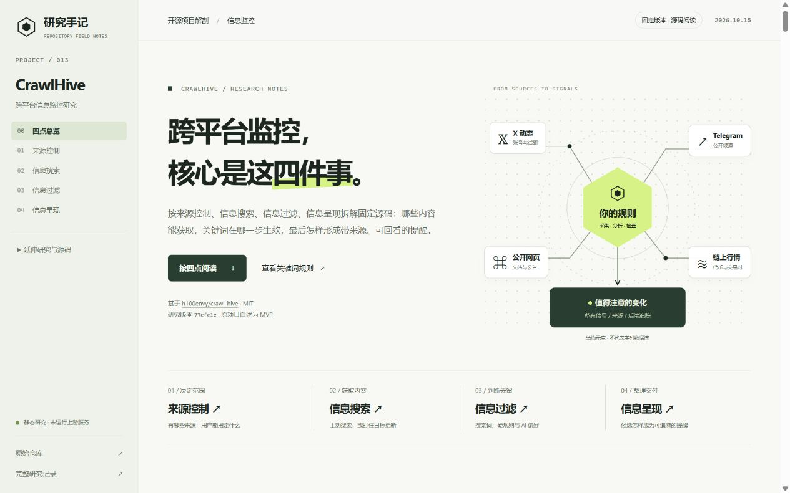
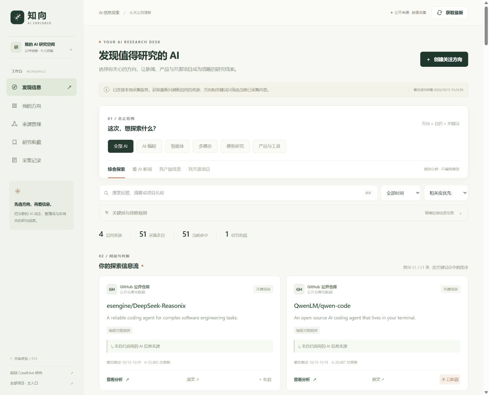

# 013 · CrawlHive：跨平台信息监控的能力与本质

CrawlHive 将 X、Telegram 公开频道、指定网页和 DexScreener 行情接成持续监控任务，经规则／可选 AI、代币关联、去重和风险检查保存交付私有信号。其原理是来源控制 → 信息搜索 → 信息过滤 → 信息呈现，按任务调度并获取增量，再判断去留、保存交付。我们的收获是可复用的来源接入知识与持续处理经验，可将领域模型改为主题、条目、事件和证据，扩展为可配置的研究入口；意义是复用关注方案、减少重复阅读并支持可追溯的判断。我们继而独立探索“方向 × 目的 × 来源 × 规则”的 AI 工作台：2026-10-15 实采 4 个公开来源、51 条内容，完成本地搜索筛选、匹配理由、收藏导出和按需刷新。研究页整理原库 4 类、本仓库 4 个及候选 13 项来源的获取方式；面向 AI 动态跟进、产品发现和开源研究，长期省时、覆盖和费用仍待评估。

本子项目包含两张独立网页：研究页用一张总图和四个核心环节解释 CrawlHive 的能力、原理、价值与扩展；“知向 · AI 探索工作台”用真实公开信息验证按方向筛选 AI 新闻、产品线索与开源项目的体验。原研究与工作台完整保留，两页和主入口互相连接。

| 信息 | 内容 |
| --- | --- |
| 原项目 | [h100envy/crawl-hive](https://github.com/h100envy/crawl-hive) |
| 固定研究版本 | [77cfe1c7a42f0d071bee49ac9ebb77fdf0556827](https://github.com/h100envy/crawl-hive/tree/77cfe1c7a42f0d071bee49ac9ebb77fdf0556827) |
| 研究日期 | 2026-10-15 |
| 理解归档与来源文档核对 | 2026-10-19；不代表重新采集工作台数据或重新运行上游 |
| 上游许可证 | MIT，Copyright (c) 2026 h100envy；[完整许可](licenses/UPSTREAM-MIT.txt) |
| 研究状态 | 研究中；源码解读与展示完成，上游实际运行、数据质量和成本待实测 |
| 本地网页 | 启动后访问 [013 中文研究网页](http://127.0.0.1:4183/1014_codex_project/013-crawl-hive/) |
| 产品原型 | [知向 · AI 探索工作台](http://127.0.0.1:4183/1014_codex_project/013-crawl-hive/explore/index.html)，源码入口 [web/explore/index.html](web/explore/index.html) |
| 主入口 | [项目总入口](http://127.0.0.1:4183/1014_codex_project/)，013 项下提供研究页和产品原型双入口 |
| 线上地址 | [理解摘要](https://yydshly.github.io/1014_codex_project/013-crawl-hive/#synthesis)、[来源目录](https://yydshly.github.io/1014_codex_project/013-crawl-hive/#source-access-catalog)、[AI 工作台](https://yydshly.github.io/1014_codex_project/013-crawl-hive/explore/index.html)；2026-10-19 已发布并核验 |

## 首屏沿用既有总图，八项摘要解释理解全貌

[能力、原理与扩展摘要](https://yydshly.github.io/1014_codex_project/013-crawl-hive/#synthesis) 依次回答源库能力、工作原理、带来的思考、实际探索、信息来源、处理流程、可扩展思路与意义、使用场景与个人价值。首屏直接使用已生成的理解总图，保留放大和下载；SVG 与完整 JPG 配图原样沿用。静态公开版保留历史快照及浏览器内筛选、收藏和导出，主动采集仍需本地 Node 服务。

[理解总图](http://127.0.0.1:4183/1014_codex_project/013-crawl-hive/#understanding-map) 串起 **原库能力与原理 → 我们的判断 → 通用化方向 → AI 研究场景 → 个人使用价值 → 来源接入**，可放大并下载 [原创 SVG](web/media/understanding-map.svg)。[六个议题摘要](http://127.0.0.1:4183/1014_codex_project/013-crawl-hive/#research-synthesis) 给出结论与边界，[来源接入目录](http://127.0.0.1:4183/1014_codex_project/013-crawl-hive/#source-access-catalog) 支持按能力层、获取方式和文字搜索筛选，再进入原有四个核心章节展开。

这里保留三个判断：

- 原库的价值包括可复用的接入实现，以及调度、增量、过滤、去重、保存和交付的组合。没有证据证明存在难以复制的数据或算法壁垒，也不能因此把它缩减成来源名单。
- 钱包、积分、行情和按币价评价信号，是原库服务交易研究场景的设计；在我们的 AI 研究场景中可以剥离。不能据此判断币相关功能对其目标用户没有价值。
- 个人使用价值预期是减少跨平台切换和重复阅读、更快留下可追溯的研究线索；节省多少时间、覆盖率和相关性尚未实测。

来源目录共 **21 项：原库源码确认的 4 类、本仓库工作台实测的 4 个来源、13 个候选来源**。候选包含厂商新闻、模型与应用目录、论文、版本更新、社区、产品发布、中文媒体和视频；其中 10 项有官方文档依据，3 项仍待确认具体自动接入路径。RSS 和 GitHub 是本仓库新增，不是原库原生能力。目录分别记录接入方式、认证限制、覆盖粒度、稳定性、成本与引用证据；“候选可接”不等于“已经接好”。完整论证见 [研究记录](RESEARCH.md)第 16 章。

2026-10-19 本轮进行理解归档与来源文档核对，工作台随站快照仍是 2026-10-15 的 51 条真实数据。总图显示与下载、目录交互、桌面及手机布局和完整构建已通过本轮验收；归档日期不代表数据刷新时间。

## 知向 · AI 探索工作台

产品目标是让“我想了解 AI”变成可操作的范围：**选择方向 → 选择目的 → 配置来源与关键词 → 阅读匹配原因和原文 → 收藏继续研究**。它是本仓库从零编写的独立探索原型，不是上游 CrawlHive 已提供的通用版，也没有调用上游币圈采集、钱包或扫描服务。

| 环节 | 已实现的体验 |
| --- | --- |
| 来源控制 | 查看 4 个来源的覆盖、最近检查时间、条目数与失败状态；启停来源并按需获取最新。 |
| 信息搜索 | 选择全部 AI、AI 编程、智能体、多模态、模型研究、产品与工具；切换综合、新闻、产品线索、开源项目目的；搜索当前已采集内容。 |
| 信息过滤 | 包含词任意／全部匹配、排除词、时间与排序；展示匹配原因和处理数量，支持保存自定义关注方案。 |
| 信息呈现 | 信息流、条目详情、来源原文、仓库星数／语言／许可证、收藏、研究清单导出与采集记录。 |

方向、关键词、来源开关等偏好及收藏保存在当前浏览器，不提供跨设备账号同步。创建关注方向不会启动后台定时任务。

首批真实快照采集于 **2026-10-15 15:15（北京时间）**，共 **51 条**：Hugging Face Blog 12 条、Google AI Blog 12 条、GitHub AI & ML Blog 10 条、GitHub 公开仓库 17 条。GitHub 按 `coding-agent`、`multimodal`、`llm-tools` 三组固定 topic 分别取当前星数最高的 6 项，重复 URL 合并为 17 个仓库；这不是新增榜或增长排行。后续刷新会改变数量与时间。

分析使用可解释的字面规则，**没有调用模型，没有 AI 生成摘要**。短摘来自 RSS 或仓库 description，Hugging Face 订阅没有摘要的条目保持空白。产品分类表示“值得进一步查看的线索”，不表示已试用；来源身份、作者主张与实测结论分开显示。

数据与运行边界详见 [来源及处理说明](web/explore/SOURCES.md)、[完整研究记录](RESEARCH.md)第 15 章。语义事件聚类、跨平台事实核查、自动定时采集、通知和模型分析仍未实现。

## 网页按四个核心环节组织

1. **来源控制**：原作已有 X、Telegram、公开网页和 DexScreener 四类监控来源；区分扫描补充数据与原作尚未接入的 RSS／GitHub。新增工作台的采集器是本仓库独立实现。
2. **信息搜索**：说明 X 查询拼接、指定频道增量读取、网页基线比较、DexScreener 的列表／关键词／地址路径。
3. **信息过滤**：区分搜索词、程序硬规则与 AI 偏好；逐来源说明生效位置、例外与最终检查；提供可编辑关键词示例。
4. **信息呈现**：解释提取、条件检查、代币关联、去重、可选分析、信号保存、私有交付与后续回看，并展示虚构信号字段。

延伸阅读保留原有 11 个章节：本质分层、12 项能力、8 步链路、信息价值、系统架构、原作截图、证据边界、通用化清单、3 组教学场景、实施路线与 26 条源码索引。侧栏先提供理解总图、议题摘要与接入目录，再进入四环节；延伸目录可展开。

关键词示例只演示共享匹配函数与词表整理，不执行实际搜索、AI、币名条件或完整信号链路。所有原作能力、教学示意和改造建议均明确区分。

## 本地运行

需要 Node.js 20 或更高版本。没有第三方前端依赖，无需安装包、配置 API 密钥或连接钱包。

```powershell
cd F:\codex_project\1014_codex_project\projects\013-crawl-hive\web
npm run dev
```

从 [项目总入口](http://127.0.0.1:4183/1014_codex_project/) 进入 013 的两个页面，也可直接打开 [研究网页](http://127.0.0.1:4183/1014_codex_project/013-crawl-hive/) 或 [AI 探索工作台](http://127.0.0.1:4183/1014_codex_project/013-crawl-hive/explore/index.html)。

```powershell
npm run check
npm run build
npm run refresh:data
```

`refresh:data` 按需采集固定公开来源并更新本地快照，不需要 API key。浏览器中的“获取最新”通过本地 Node 服务后台执行；来源失败时保留上次条目并标记过期，最多保留 20 轮采集日志。

构建结果位于 web/dist/，包含原研究页与 explore/ 产品页、静态资源和真实 snapshot.json，资源使用相对地址，可复制到总站点的 013-crawl-hive/。静态部署可基于内置快照浏览，实时刷新依赖本地 Node 服务；服务端采集模块和 .runtime/ 缓存不进入静态产物。2026-10-19 已发布并核验。

## 公开部署与验证

已通过既有GitHub Actions发布，完整站点保留原七个项目。26份首发静态文件、19个入口与资料地址、101个唯一页面编号已核对；浏览器确认摘要、来源筛选、工作台快照与桌面／手机布局。公开构建不请求采集API或本机地址，不含服务端和运行缓存。完整记录见[部署记录](deployment.json)与[HTTP验收](public-verification.json)。

## 网页预览



[来源接入目录实际截图](assets/source-access-catalog.jpg) · 原创总图可从网页下载 SVG；原有研究和产品截图继续保留。



[手机视口截图](assets/mobile.jpg) · 仅展示本研究网页，不代表上游运行。



[产品原型手机视口截图](assets/explorer-mobile.jpg) · 展示本仓库新建的独立产品原型，数据时间以页面标注为准。

## 核心结论

- 核心是面向特定领域的持续信息处理流水线，已有来源适配、增量游标、调度、规则／AI、检查和私有交付。
- 可复用价值在接入实现与整条处理链路的组合；难以复制的数据、算法或商业壁垒没有充分证据。领域专用功能是否有用，应结合目标用户评价。
- 当前模型与代币、链、币价结果、钱包身份和积分机制深度耦合；每个任务只有一种来源。
- 当前去重主要按代币与信号类别进行，尚无通用的跨平台事件关联层。
- 网页变化检测可以产生不带币名的 doc_update；“无币名就丢弃”只适用于共享的无 AI 文本提取规则，不能扩大到所有来源。
- README 的代币、市场与默认预算存在新旧内容冲突；源码有实现不能证明线上开放状态或长期效果。
- 通用化可行，但需要重构主题、事件、身份、评价和存储，并逐个平台接入数据来源。

## 来源与改动

本项目原创编写中文分析、研究网页、理解总图、来源接入目录、结构示意、交互演示，以及知向 AI 探索工作台的界面、规则筛选和公开来源采集器；没有复制或修改上游业务源码，没有部署上游监控服务。3 张上游产品截图来自固定版本 docs/images/，来源见 [配图记录](assets/README.md)；已交付的研究网页和知向原型预览为本地浏览器实际截图，本轮总图和接入目录截图也已经验证。公开来源内容保留原作者与原文链接，仓库许可证只展示当前接口字段，使用前仍需审阅对应 LICENSE。[完整研究记录](RESEARCH.md) 列出证据、待验证事项和改造建议。

[返回项目总索引](../../README.md)
